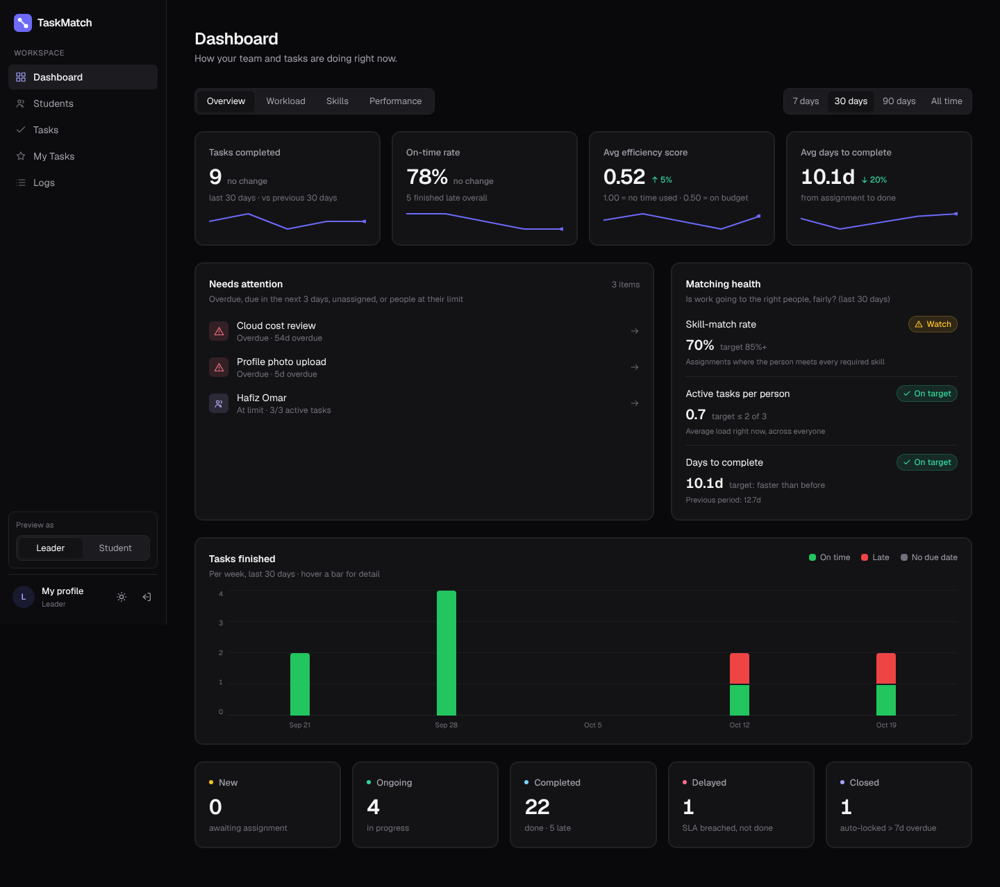
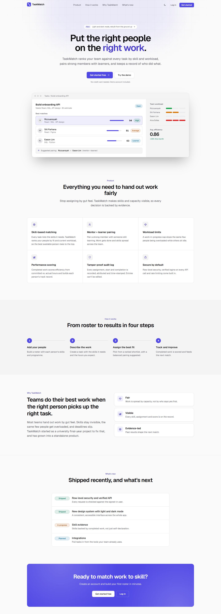
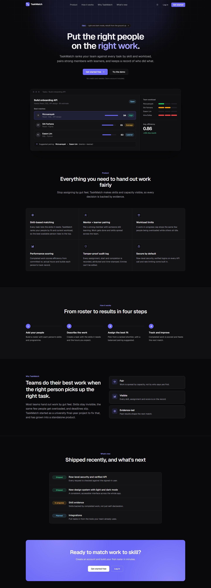
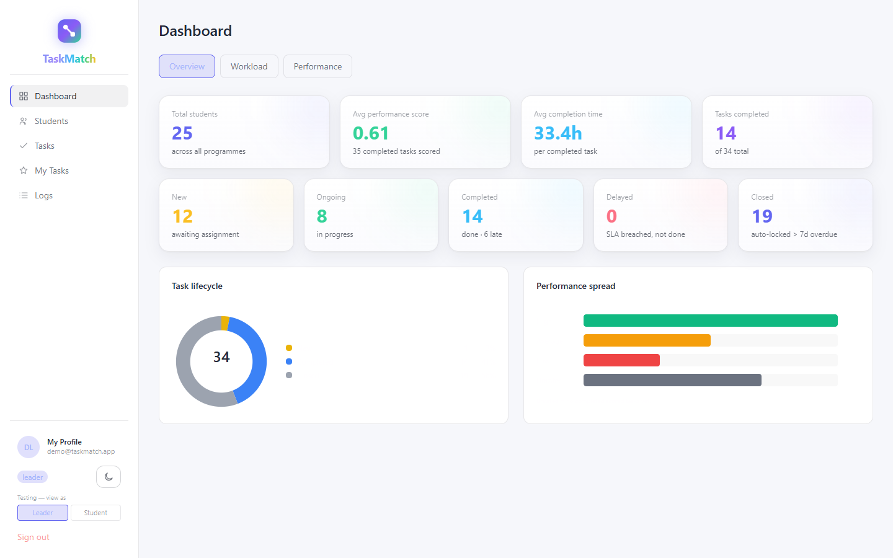
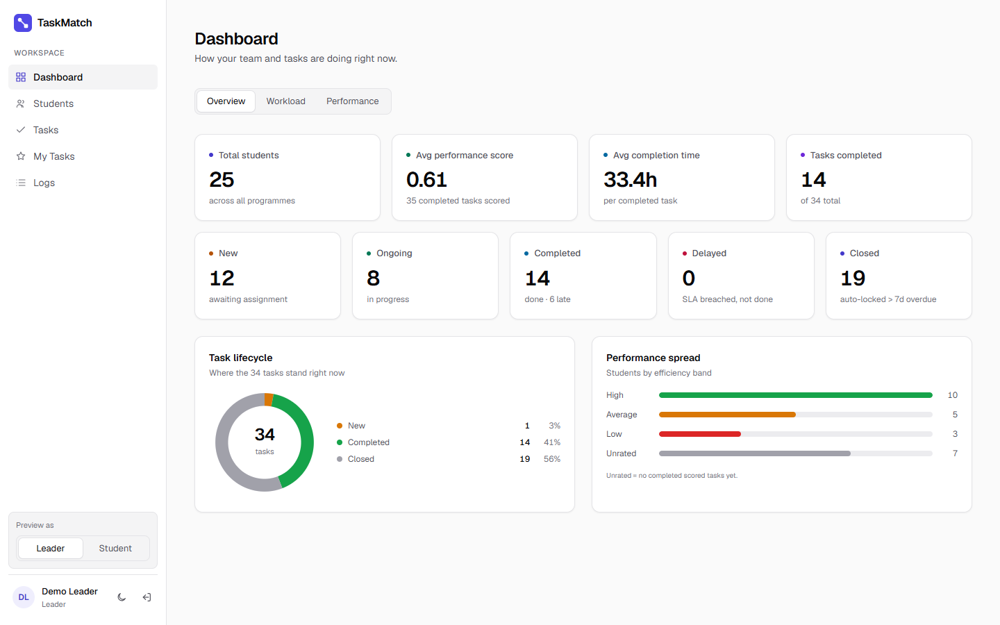
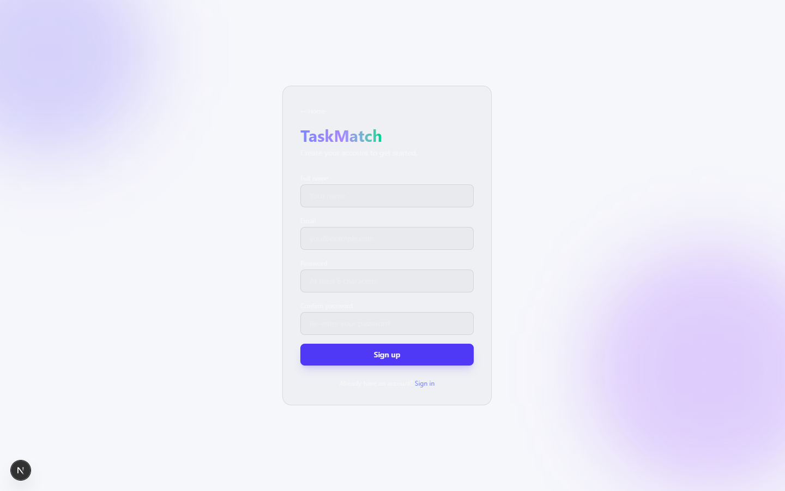
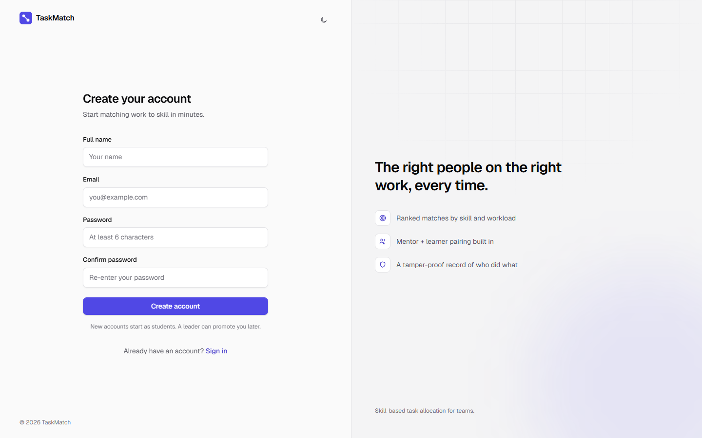
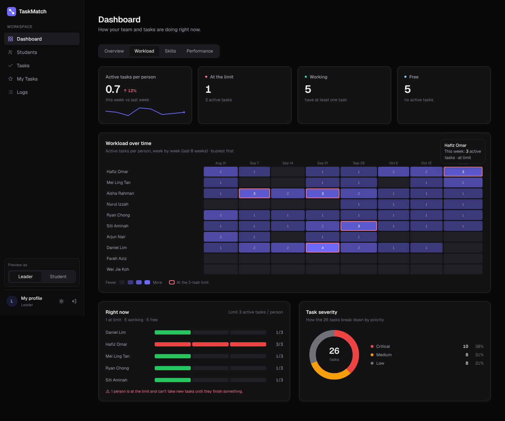
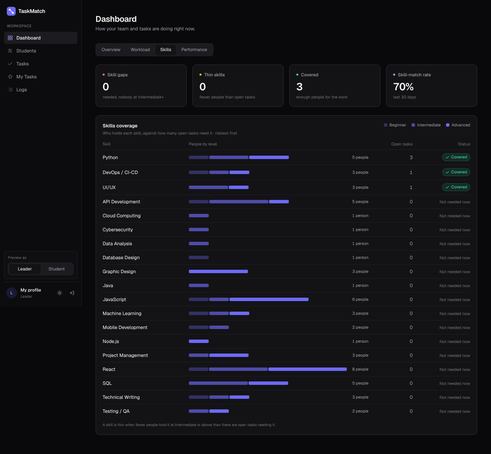

# TaskMatch 2.0

**Skill-based task matching for teams.** TaskMatch looks at the skills a task needs,
finds the people who have them, checks who has room to take more work, and helps a
lead assign it with the reason for every pick shown up front.



| Light | Dark |
|---|---|
|  |  |

---

## Why this exists

TaskMatch started as my Final Year Project at Universiti Teknologi PETRONAS (UTP).
The original version ([7YMERA/taskmatch-git](https://github.com/7YMERA/taskmatch-git))
proved the idea: match people to tasks by skill instead of by whoever happens to be
free, cap how much work any one person carries, and pair strong members with learners
so skills spread across the team.

It worked, and it was well received. But it was still built like a student project:
keys in the code, endpoints anyone could call, a rainbow colour scheme with a light
mode that broke on half the pages, and a dashboard that showed totals rather than
answers.

TaskMatch 2.0 is a passion project to take that idea the rest of the way. The aim is
an app that holds up by today's standards, one I would be comfortable putting in front
of real teams and, one day, offering as a product.

## Goals

1. **Production-grade engineering.** Secure by default, tested, checked by CI on
   every push, and documented well enough that someone else can run it.
2. **A professional, modern look.** One coherent design system, calm neutral colours
   with a single brand accent, and light and dark modes that both actually work.
3. **Features a real team would expect.** Dashboards that answer "what needs me
   today?", automatic assignment, roles, audit history, notifications and more.
4. **Smarter matching.** Move beyond self-declared skills toward evidence from
   completed work, with a score leaders can understand and tune.
5. **Show the journey.** Every change is recorded with before/after screenshots, so
   the difference between the FYP and 2.0 is visible, not just claimed.

---

## Old vs new at a glance

| Area | Original FYP | TaskMatch 2.0 |
|---|---|---|
| **Secrets** | Supabase key hard-coded in the source | All keys in environment variables; the exposed key was rotated |
| **API access** | Read endpoints open to anyone | Every endpoint except `/health` needs a verified login token |
| **Identity** | Who-is-acting taken from the request body | Taken from the verified token, so actions can't be forged |
| **Database** | Row-level security off on most tables | RLS on every table ([`supabase/rls.sql`](supabase/rls.sql)) |
| **Abuse protection** | None | Per-IP rate limiting, locked-down CORS, typed request validation |
| **Errors** | Raw 500s | Handled globally with clean responses |
| **Tests and CI** | None | pytest suite (matcher, security, assignment modes) and GitHub Actions on every push and PR |
| **Look and feel** | Six-colour palette; white-on-white text in light mode | Neutral base with one indigo accent, per-theme tokens, Geist type, theme follows your OS |
| **Dashboard** | Totals at one point in time | Date ranges, KPI trends with sparklines, "needs attention", matching health, workload heatmap, skills coverage |
| **Assigning work** | Pick a person from a ranked list | Also auto-assign by best match, round robin or least loaded, previewed with the reason before confirming |
| **Dialogs** | Browser `prompt()` boxes | Themed in-app dialogs |
| **Documentation** | Default framework README | Setup guides, API reference, roadmap and visual changelogs |

---

## What's been enhanced so far

### 1. Security hardening ([#1](https://github.com/7YMERA/taskmatch-2.0/pull/1))
- Login required on every read endpoint, not just the write ones.
- Per-IP rate limiting (`RATE_LIMIT_PER_MINUTE`, default 120) that returns `429` with `Retry-After`.
- One shared Supabase client in the frontend instead of a copy in every file.

### 2. Row-level security ([#3](https://github.com/7YMERA/taskmatch-2.0/pull/3))
- RLS switched on for all nine tables, so the public key alone can no longer read or write data.
- The API uses the server-only service-role key for its queries.

### 3. Modern redesign ([#4](https://github.com/7YMERA/taskmatch-2.0/pull/4), plus [#2](https://github.com/7YMERA/taskmatch-2.0/pull/2))
- A new design system in `taskmatch/app/globals.css` and `taskmatch/app/components/ui.tsx`.
- Every page rebuilt or restyled: landing, sign in, sign up, app shell, dashboard,
  tasks, students, detail pages, My Tasks, profile and the activity log.
- Light mode fixed everywhere; every colour is defined per theme so text stays readable.
- **Full before/after gallery, light and dark: [docs/REDESIGN.md](docs/REDESIGN.md)**

| Before | After |
|---|---|
|  |  |
|  |  |

### 4. Phase 1: dashboards and auto-assign ([#5](https://github.com/7YMERA/taskmatch-2.0/pull/5))
- **Overview:** KPI tiles with change against the previous period, "needs attention"
  (overdue, due soon, unassigned, people at their limit), matching health against the
  project's original success targets, and tasks finished per week.
- **Workload heatmap** of active tasks per person over the last 8 weeks.
- **Skills coverage:** which skills are covered, thin or a gap for the open work.
- **Assignment modes** through a new `POST /auto-assign` endpoint, with a dry-run
  preview so the lead always sees who and why before confirming. Every automatic
  pick is written to the activity log.
- **Details and screenshots: [docs/PHASE1-DASHBOARD.md](docs/PHASE1-DASHBOARD.md)**

| Workload heatmap | Skills coverage |
|---|---|
|  |  |

### In progress
- **Phase 1b:** rebuilding the Tasks and People pages with views, saved filters and a skills matrix.

The earliest login and landing revamps are in [docs/CHANGELOG-VISUAL.md](docs/CHANGELOG-VISUAL.md).

---

## How matching works

1. A lead creates a task and tags the skills it needs.
2. The API scores every person against those skills, using the level they hold for each.
3. People who are already at the work-in-progress limit (3 active tasks) are left out.
4. The result is a ranked list: strongest skill match first, then least busy. A strong
   member can be paired with a learner so skills spread.
5. The lead assigns from the list, or lets TaskMatch pick by mode:

| Mode | Who it picks |
|---|---|
| Best match | Top of the ranked list |
| Round robin | Whoever has gone longest without a new task |
| Least loaded | Fewest committed hours on active tasks |

Completed work is scored for efficiency, and a task that is still unfinished 7 days
past its due date is closed and locked automatically.

---

## Tech stack

| Layer | Tech |
|---|---|
| Frontend | [Next.js 16](https://nextjs.org) (App Router), React 19, TypeScript, Tailwind CSS v4 |
| Backend | [FastAPI](https://fastapi.tiangolo.com) (Python 3.11+), Pydantic |
| Database and auth | [Supabase](https://supabase.com) (Postgres, Auth, Storage) with row-level security |
| Testing and CI | pytest, TypeScript type-check, ESLint, GitHub Actions |
| Hosting (suggested) | Vercel for the frontend, Render for the API |

## Repository layout

```
taskmatch/        Next.js frontend (pages in app/, design system in app/components/ui.tsx)
taskmatch-api/    FastAPI matching and task engine (main.py) with its tests
supabase/         Database security policies (rls.sql, then roles.sql, then workspaces.sql)
docs/             Roadmap, redesign and Phase 1 write-ups, screenshots
.github/          CI workflow
```

---

## Running it locally

You need **Node.js 20+**, **Python 3.11+** and a free **Supabase** project.

### 1. The API

```bash
cd taskmatch-api
python -m venv .venv
source .venv/bin/activate          # Windows: .venv\Scripts\activate
pip install -r requirements.txt
cp .env.example .env               # then fill in your Supabase values
uvicorn main:app --reload --port 8000
```

Interactive API docs are at http://localhost:8000/docs. Every environment variable and
endpoint is explained in [taskmatch-api/README.md](taskmatch-api/README.md).

### 2. The database

In the Supabase SQL Editor, run [`supabase/rls.sql`](supabase/rls.sql) once to switch on
row-level security. Set `SUPABASE_SERVICE_ROLE_KEY` for the API first, because the API's
queries rely on it.

Then run [`supabase/roles.sql`](supabase/roles.sql) once. It moves every account's role to a place
only the server can change (existing leaders become admins, everyone else members), adds the
"away" date, and sets the database rules for each role.

Then run [`supabase/workspaces.sql`](supabase/workspaces.sql) once. It adds workspaces and
projects. Everything you already have goes into one workspace called "My team", and every
existing account joins it with the role it has now. Admins rename it, send invite links and
change roles on the **Members & roles** page. New accounts create their own workspace or join
one with an invite link.

### 3. The frontend

Create `taskmatch/.env.local`:

```bash
NEXT_PUBLIC_SUPABASE_URL=https://your-project.supabase.co
NEXT_PUBLIC_SUPABASE_ANON_KEY=your-publishable-key
NEXT_PUBLIC_API_URL=http://localhost:8000
```

Then:

```bash
cd taskmatch
npm install
npm run dev
```

Open http://localhost:3000.

### Tests

```bash
cd taskmatch-api
pip install -r requirements-dev.txt
python -m pytest
```

CI runs the backend tests and the frontend type-check on every push and pull request.

> Never commit `.env` or `.env.local`. Both are git-ignored, and the service-role key
> must only ever live on the server.

---

## Roadmap

The full plan is in [docs/ROADMAP.md](docs/ROADMAP.md). In short:

**Level 1: production-grade** (nearly done). Security, validation, tests, CI and docs are
in. Left: a detailed `/health` check, storage policies for avatars, and blocking lint in CI.

**Feature overhaul**, one phase per pull request, each with before/after screenshots:

| Phase | Scope | Status |
|---|---|---|
| 1 | Dashboards, analytics and assignment modes | ✅ done |
| 1b | Tasks and People pages rebuilt (views, saved filters, skills matrix) | ◐ in progress |
| 2 | Roles and permissions, audit trail, user management, "away" status | ☐ planned |
| 3 | Task board, approvals, notifications, comments, AI-suggested skills and estimates (always confirmed by a person) | ☐ planned |
| 4 | Global search, Ctrl+K command palette, exports, settings, multiple teams | ☐ planned |

**Level 2: smarter matching.** Skill evidence from completed tasks, skill decay over
time, per-person capacity instead of a flat limit, and an explainable, tunable score.

**Level 3: a product.** Multiple teams and organisations, integrations such as GitHub
Issues and Jira, and a feedback loop so matching learns from outcomes.

---

## Credits

Built by [@7YMERA](https://github.com/7YMERA). TaskMatch began as a Final Year Project at
Universiti Teknologi PETRONAS; 2.0 continues it independently, with AI coding assistants
used as pair programmers along the way.
