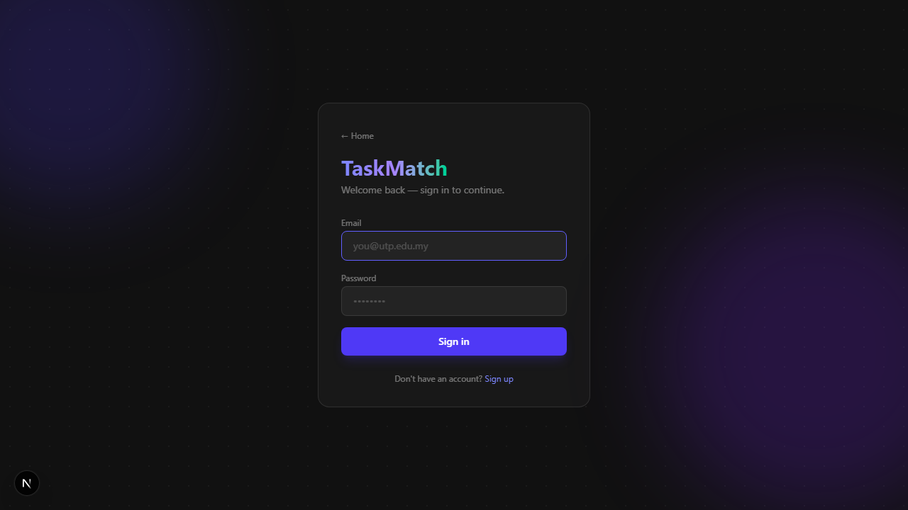
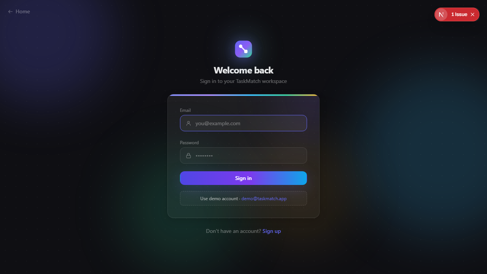
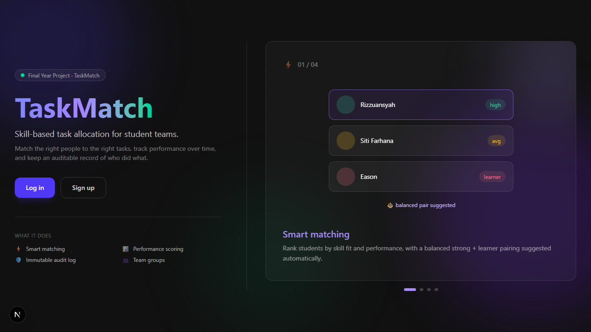
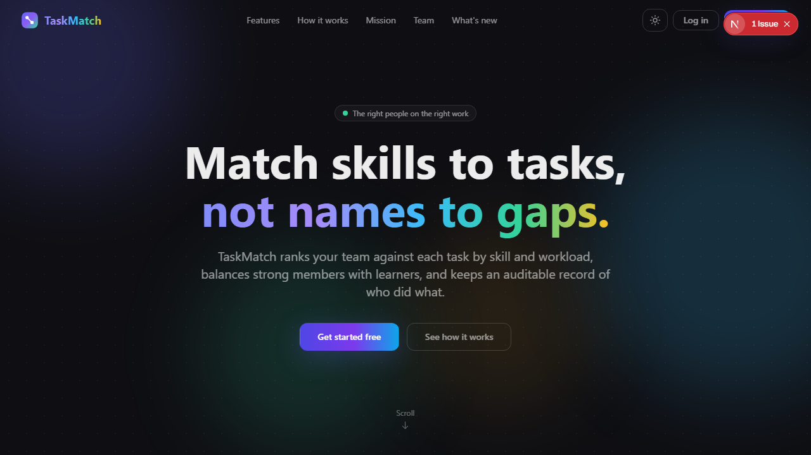
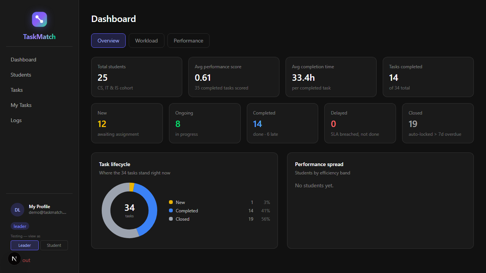
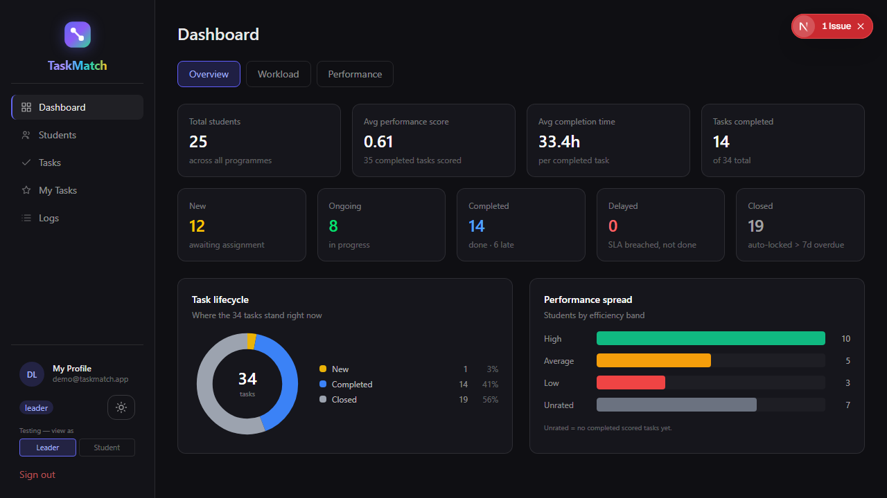

# TaskMatch 2.0 — Visual Changelog

A before / after record of the big UI revamps between the original project
(`taskmatch-git`) and TaskMatch 2.0. "Before" shots are the original app running
unchanged; "after" are the current 2.0 UI. Both captured against the same data.

---

## Login

The original login was a single flat card. 2.0 rebuilds it as a centered card
with a logo header, a gradient accent bar, icon-prefixed fields, a gradient
button, and a one-click demo-account fill.

| Before | After |
|---|---|
|  |  |

---

## Landing page

The original landing was a single-screen split. 2.0 is a full long-scroll
marketing page — sticky nav, hero, feature sections, mission, team and a
"what's new" roadmap — with a multi-colour palette and light/dark themes.

| Before | After |
|---|---|
|  |  |

---

## Dashboard

Same data, refreshed shell: outline-icon sidebar with an active-page highlight,
a theme toggle, token-based surfaces, and a fully rendered performance-spread
panel. Generic copy replaces course-specific wording.

| Before | After |
|---|---|
|  |  |

---

## What changed (summary)

- **Design system** — one set of CSS tokens drives every colour, surface and
  radius; reusable `Button`, `Card`, `Badge`, `Icon` components.
- **Light / dark mode** — a theme toggle that flips the whole app, remembered
  across visits.
- **Professional icon set** — outline (stroke) icons replace all emoji.
- **Colour** — a multi-hue palette (indigo, violet, sky, emerald, amber, rose)
  with per-section accents and tinted cards, instead of flat black + purple.
- **Responsive** — the sidebar collapses to a mobile menu; grids reflow.
- **Neutral branding** — course-specific wording removed.

> Screenshots are regenerated with the old repo running on `:3001` and the new
> app on `:3000`; see `docs/` for how the comparison was produced.
