# TaskMatch 2.0: People page and smarter matching (before / after)

This phase does two things. It makes the People page answer the questions a lead actually has
("who should take this?", "where are we thin?", "who is overloaded?"), and it replaces the
matcher's simple ranking with a **fit score** that explains itself. It also makes the free,
built-in task suggestions smarter.

No AI and no paid service is involved. Everything is worked out from the team's own data, so it
costs nothing to run. There are **no database changes** in this phase, so there is no SQL to run.

This is the first step into Level 2 of the [roadmap](ROADMAP.md) (smarter matching): skill
evidence from finished work, evidence that fades with age, hours as well as a task count, and an
explainable score.

## The fit score

Every person gets a score out of 100 for a piece of work. It is the sum of four parts, and the app
always shows the parts (press **Why?** next to anyone):

| Part | Points | What it measures |
|---|---|---|
| Skills | 45 | Do they have each required skill at the required level? Meeting the minimum is most of it; a higher level adds a little. |
| Proven experience | 20 | Have they actually **used** these skills on finished work, not just declared them? Older work counts for less (half as much after 180 days). Finishing a task with similar wording also counts. |
| Availability | 20 | Room to take it on: free slots against the 3-task limit, and hours on active tasks against a 20-hour capacity. Whichever is tighter wins. Someone away scores 0 here. |
| Track record | 15 | Finished on time, and their average score. Someone with no history gets a neutral half, so new people aren't buried. |

Two rules keep it honest:

- People who meet every required skill are always listed first. The score orders people within
  each group.
- Someone below the level for any required skill is capped at 54 ("Possible"), so being free and
  reliable can't make a person who lacks the skills look like a good fit.

The score is used everywhere people are ranked: task recommendations, **Auto-assign → Best match**,
**Find a match** on the People page, **Who could take this?** in New task, and the "Good fit for"
list on someone's quick view. The rules live in one file, `taskmatch-api/matching.py`, with the
weights at the top. Two can be changed without code, as environment variables on the API:
`CAPACITY_HOURS` (default `20`) and `EVIDENCE_HALF_LIFE_DAYS` (default `180`).

When someone doesn't fully fit, the reason now names a **mentor**: the strongest available person
with the missing skill, so a growth pairing comes with a concrete partner.

## People page

| Before | After |
|---|---|
| 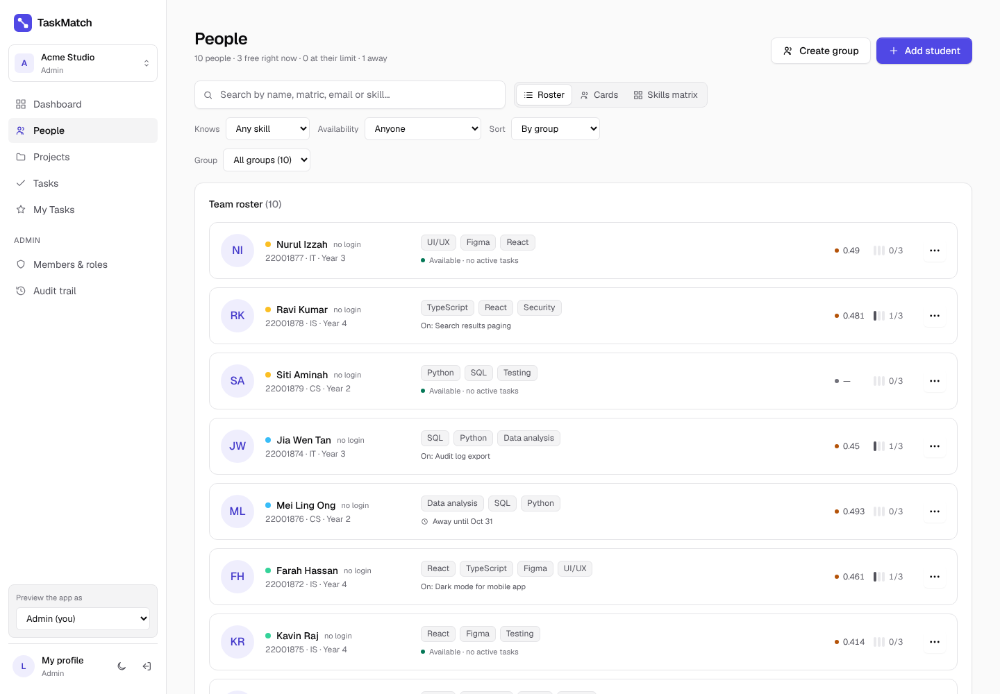 | 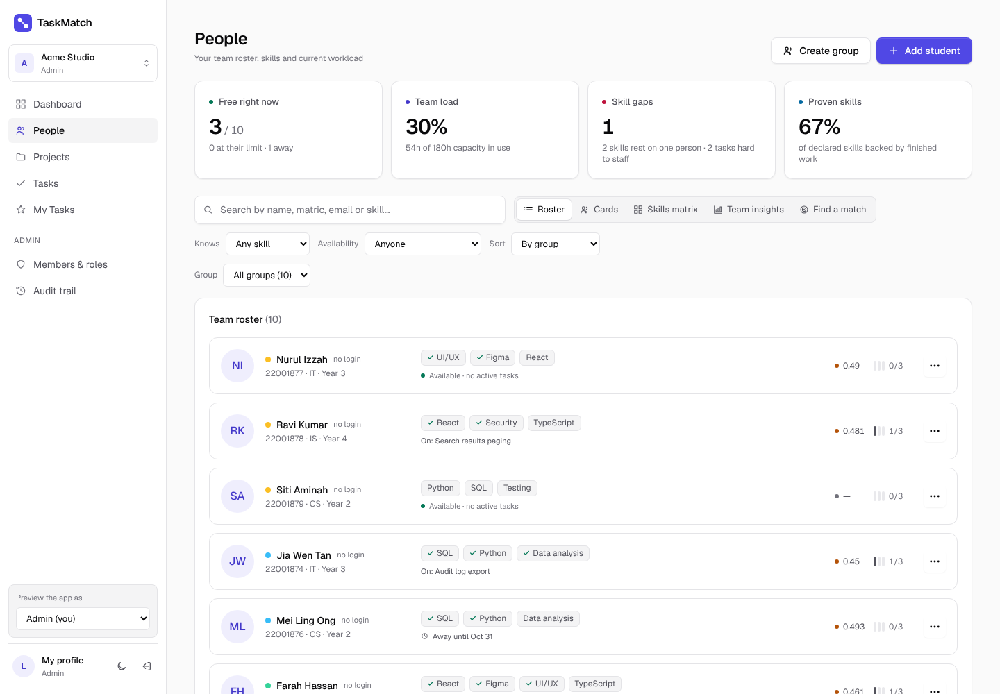 |
| 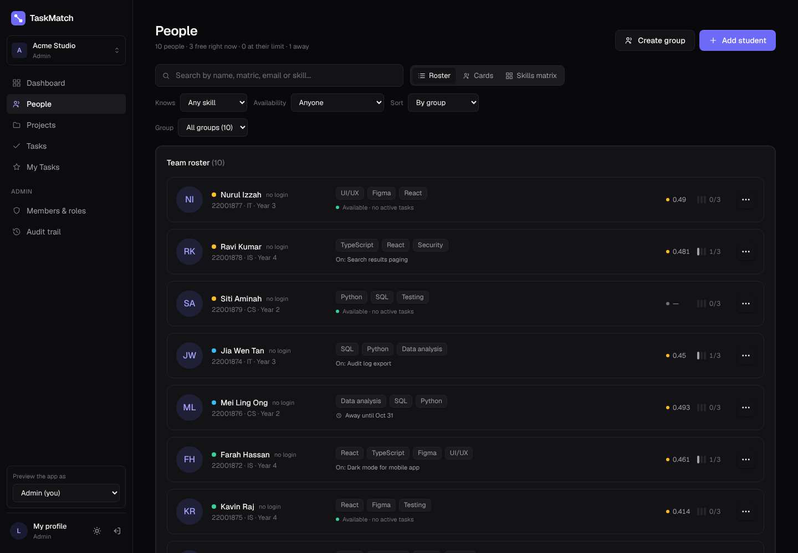 | 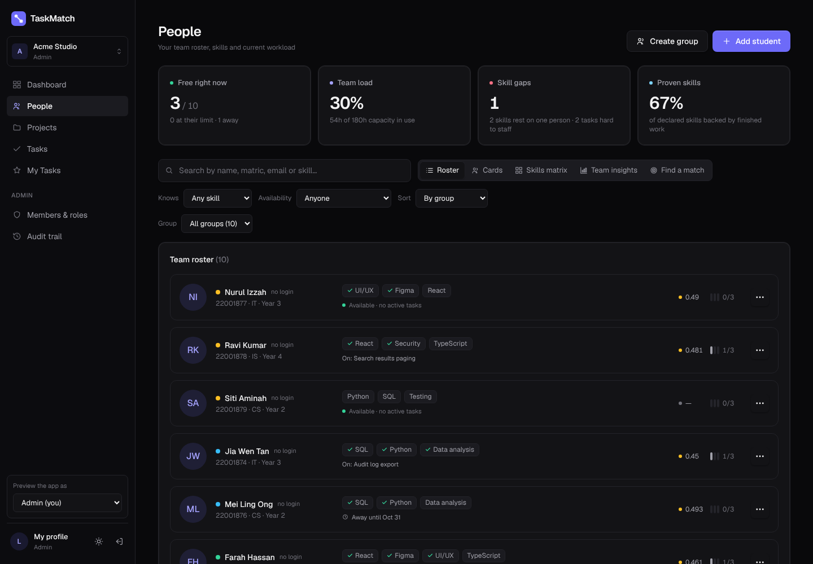 |

- **Team at a glance.** Four tiles: who is free right now, team load in hours against capacity,
  skill gaps (and skills that rest on one person), and how much of the declared skill data is
  backed by finished work.
- **Proven skills.** A small tick on a skill means the person has used it on finished work. Proven
  skills are listed first. In the skills matrix, a green underline marks them.

### Team insights (new tab)

| Light | Dark |
|---|---|
| 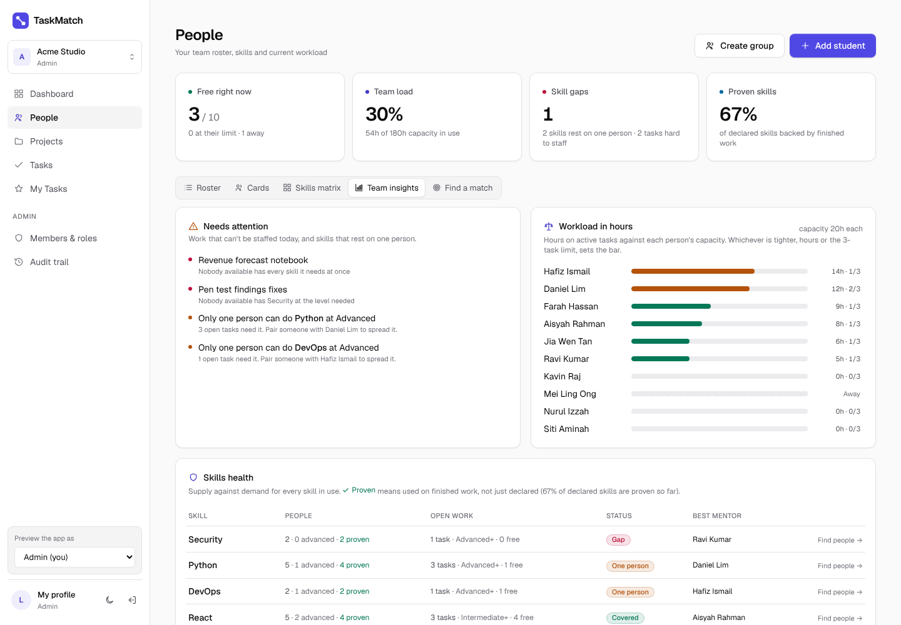 | 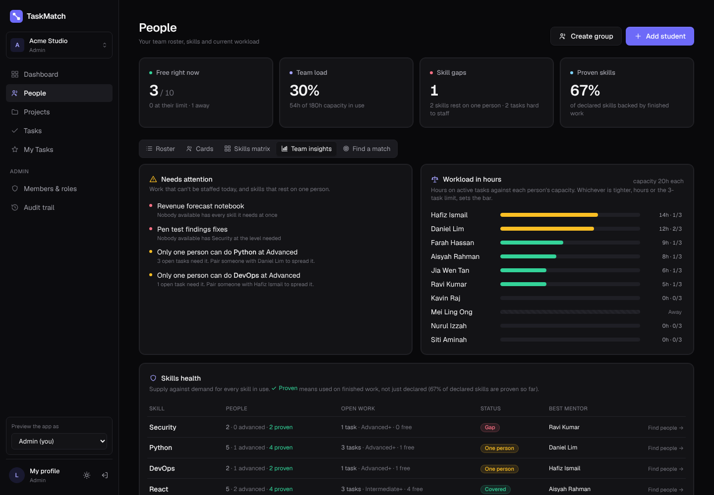 |

- **Needs attention:** open tasks that nobody available can take, and skills where only one person
  has the level open work needs, with who to pair them with.
- **Workload in hours:** everyone's active hours against their capacity, coloured when they get
  close to full. Click a name for their quick view.
- **Skills health:** for every skill, how many people have it, how many at Advanced, how many have
  proven it, how much open work needs it, a status (Gap, One person, No expert, Covered) and the
  best mentor. **Find people →** jumps to the finder with that skill picked.

### Find a match (new tab)

| Light | Dark |
|---|---|
| 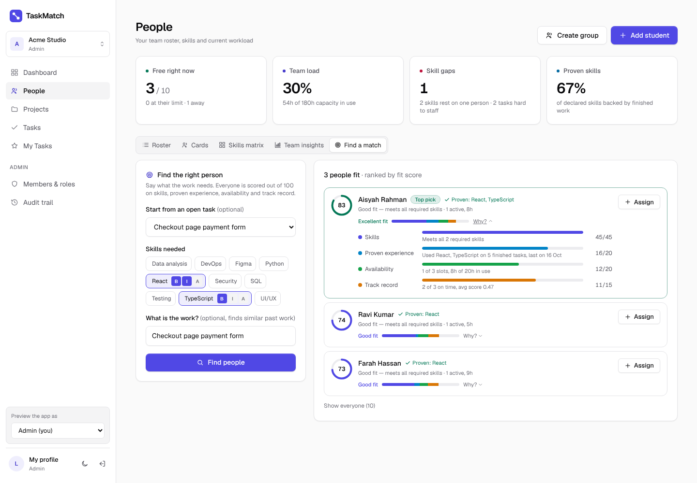 | 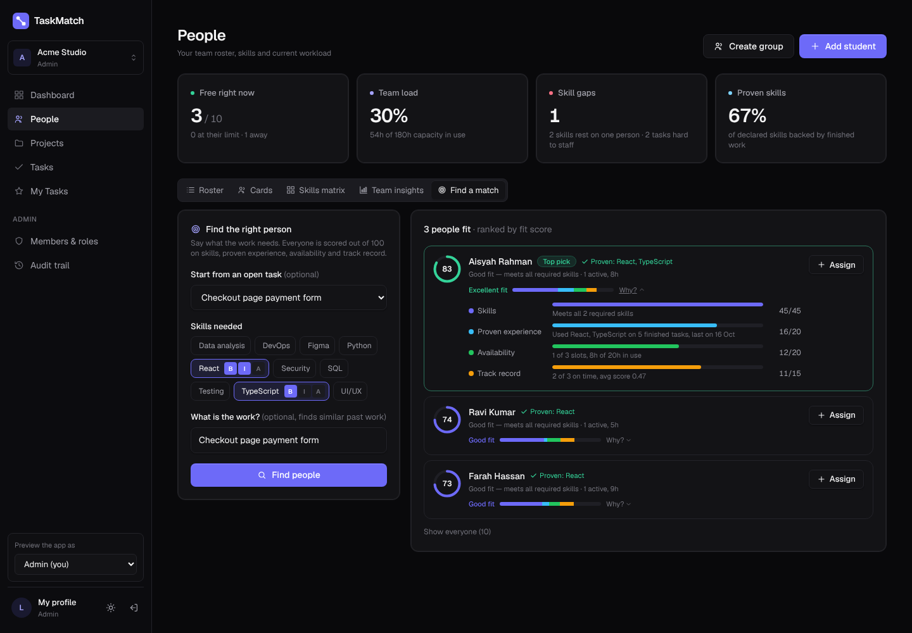 |

Pick the skills and levels the work needs, or start from an open task, optionally describe it, and
press **Find people**. Everyone is ranked by fit score with the reasons. Starting from an open task,
admins and team leads can assign straight from the list.

### Person quick view

| Before | After |
|---|---|
| 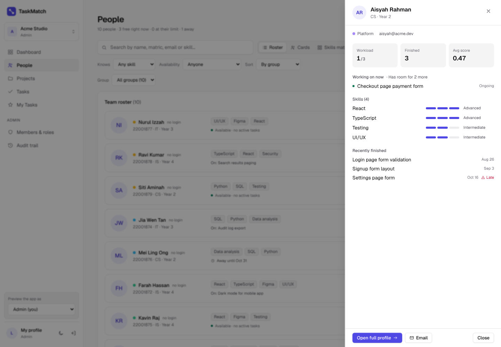 | 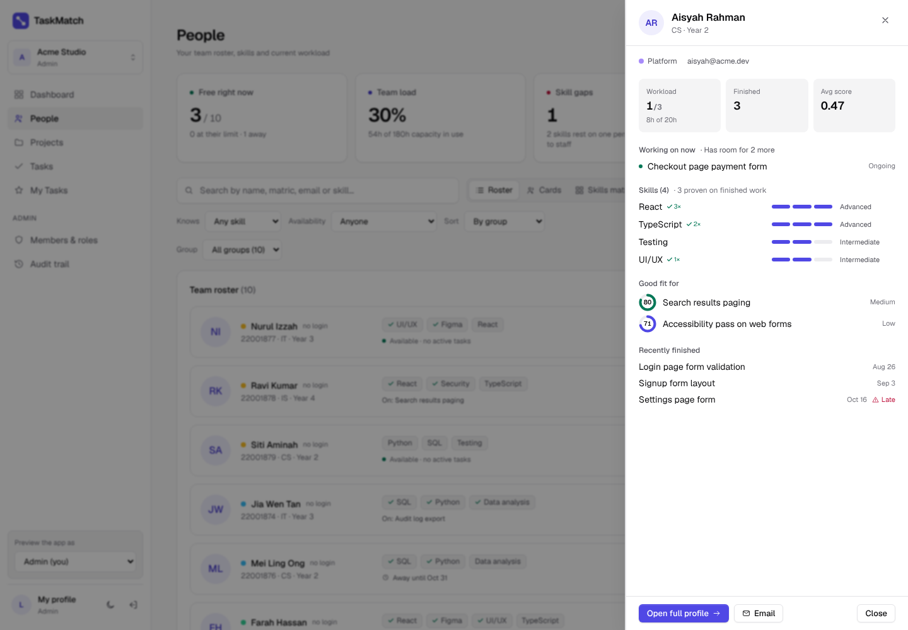 |

Adds their active hours against capacity, which skills are proven (and how many times), and the
open tasks they are the best fit for, with the score.

## Task recommendations

| Before | After |
|---|---|
| 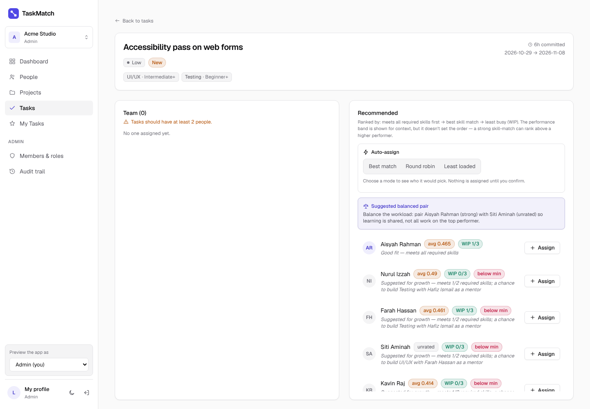 | 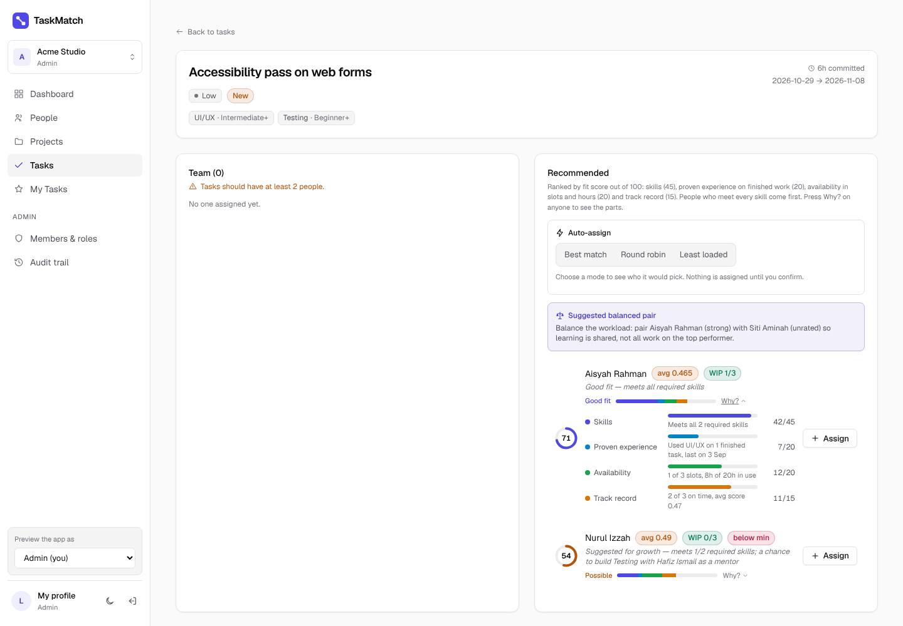 |

Each recommended person now has a score ring and a stacked bar showing where their points come
from. **Why?** opens the breakdown. Dark mode:
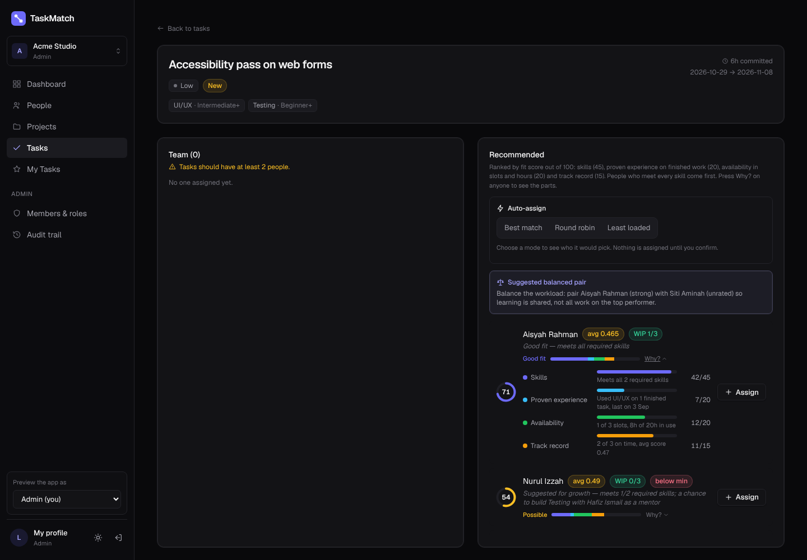

## New task: who could take this, and smarter suggestions

| Who could take this? (dark) | Suggestions with the estimate note (light) |
|---|---|
| 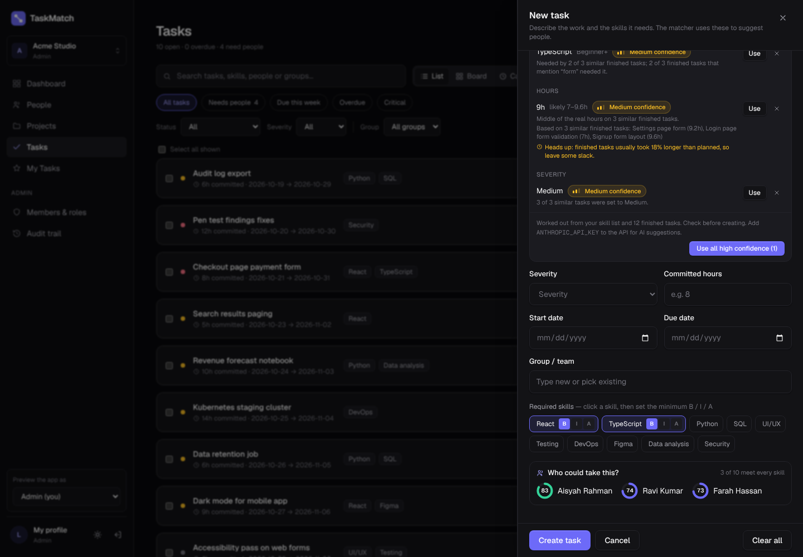 | 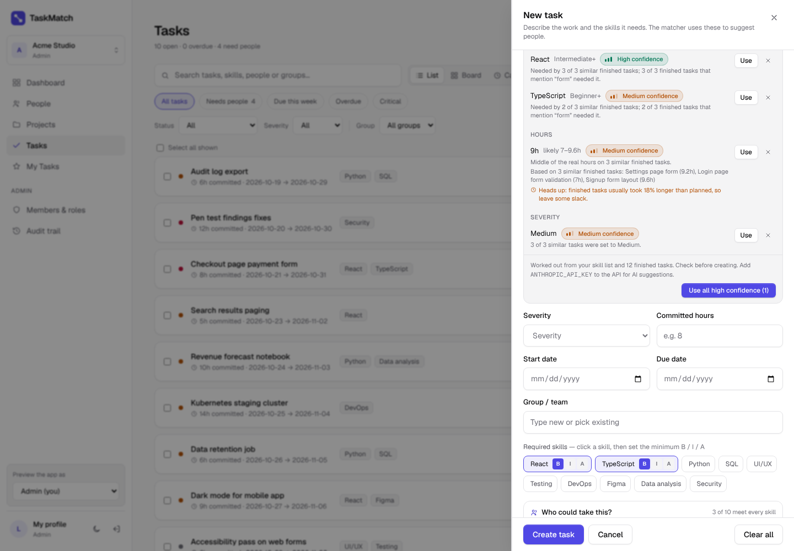 |

- **Who could take this?** As soon as skills are picked, the top three people by fit score, and how
  many meet every skill. If nobody does, it says so before the task is created, with the closest
  person and a mentor.
- The free **Smart suggestions** engine (used when there's no AI key) got smarter:
  - **Rare words count for more.** Sharing "webhook" with a past task says more than sharing "form".
  - **Short forms are understood:** "JS" finds JavaScript, "db" finds database work, "postgres"
    finds PostgreSQL.
  - **It learns which words go with which skills.** If most finished tasks that mention "login"
    needed a skill, a new "login" task suggests it too, and says so ("3 of 3 finished tasks that
    mention "login" needed it").
  - **Estimate note.** If the team's finished tasks usually take longer than planned, the hours
    suggestion says by how much, so leads can leave slack.

## API changes

| Method | Path | Who | What |
|---|---|---|---|
| POST | `/match/people` | signed in | rank everyone for any skills (+ optional description) |
| GET | `/people/insights` | signed in | load in hours, proven skills, skill coverage and risk, tasks nobody can take |
| GET | `/recommend/{task_id}` | signed in | now also returns `fit_score`, `fit_factors`, `proven`, `active_hours`, `mentor` per person |
| GET | `/recommend-tasks/{student_id}` | signed in | now sorted by fit score, with `fit_score` per task |
| POST | `/ai/suggest-task` | admin, lead | built-in engine adds `hours.note` |

Tests: `taskmatch-api/test_matching.py` (new) covers the score, evidence decay, the cap, mentors,
skill risk and both new endpoints; `test_suggest_history.py` covers aliases, rare-word weighting,
learned hints and the estimate note.

## Deploying

Nothing to run in Supabase. Merge the pull request: Vercel redeploys the app and Render redeploys
the API. Both are needed, because the new People tabs call the new API endpoints. Until the API is
updated, the People page works as before and just doesn't show the new tiles. If Render hasn't
started a new deploy a few minutes after the merge, open the service on render.com and press
**Manual Deploy → Deploy latest commit**.
