# TaskMatch 2.0: Phase 1, dashboards and assignment modes (before / after)

Phase 1 of the feature overhaul. The dashboard used to show totals for one moment in time; it now answers
"what needs me today, and is it getting better or worse?". Leads can also hand out work automatically
by best match, round robin or least loaded, with the reason for every pick shown before they confirm.

No database changes were needed: every number comes from tables the app already has.

## What changed

### Dashboard (`app/dashboard/page.tsx`, `app/lib/analytics.ts`, `app/components/charts.tsx`)

- **Date range** (7 days, 30 days, 90 days, all time) and the **current tab** live in the page
  address, so a filtered view can be bookmarked or shared.
- **Overview**
  - KPI tiles with **change against the previous period** and a sparkline: tasks completed,
    on-time rate, average efficiency score and average days from assignment to done.
  - **Needs attention**: overdue tasks, tasks due in the next 3 days, tasks nobody is on, and people
    at their limit. Every row links to the task or person.
  - **Matching health**: the success measures the original project set itself (85%+ skill match,
    no more than 2 active tasks each, faster completion), each with an On target / Watch status.
  - **Tasks finished** per week (per day for the 7-day range), split into on time, late and no due date.
  - The lifecycle tiles (New, Ongoing, Completed, Delayed, Closed) still open the filtered task list.
- **Workload**: a **heatmap** of active tasks per person for the last 8 weeks, busiest first, with
  cells at the limit outlined. The live "right now" slot meters and the severity mix sit below it.
- **Skills** (new tab): **skills coverage**, showing who holds each skill by level against how many
  open tasks need it. Skills are flagged as a Gap (needed, nobody at Intermediate or above), Thin
  (fewer people than tasks) or Covered.
- **Performance**: unchanged.

All charts are hand-drawn SVG/HTML on the existing theme tokens, so they follow light and dark mode.
Every bar and heatmap cell has a hover (and keyboard focus) tooltip, every multi-series chart has a
legend, and status is always shown as an icon plus a word, never colour alone.

### Assignment modes (`taskmatch-api/main.py`, `app/tasks/[id]/page.tsx`)

| Mode | Who it picks |
|---|---|
| Best match | Top of the ranked list: strongest skill match, then least busy |
| Round robin | Whoever has gone longest without a new task (never assigned goes first; ties go to whoever has had fewer tasks overall) |
| Least loaded | Fewest committed hours on their active tasks |

- Only qualified people are ever picked: they meet every required skill and are under the limit of 3.
- New endpoint `POST /auto-assign` (leaders only). `dry_run: true` previews the pick without
  assigning anyone; the task page uses this so the lead always sees who and why before confirming.
- The matcher's scoring was pulled out into `score_candidates()`, so the ranked list and the
  automatic pick can never disagree.
- Every automatic assignment is written to the activity log with its mode and reason.
- 14 new tests in `taskmatch-api/test_assignment_modes.py`, including a check that round robin
  rotates A, B, C, A across repeated picks.

## Screens

All screenshots use the same seeded demo data, at 1440×900.

### Dashboard overview

| | Before | After |
|---|---|---|
| Dark | 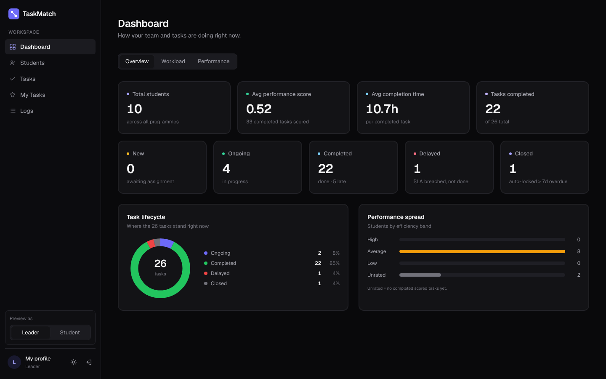 |  |
| Light | 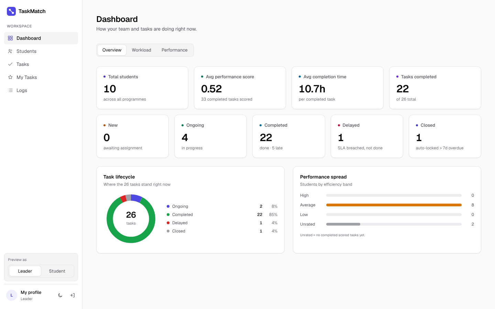 | 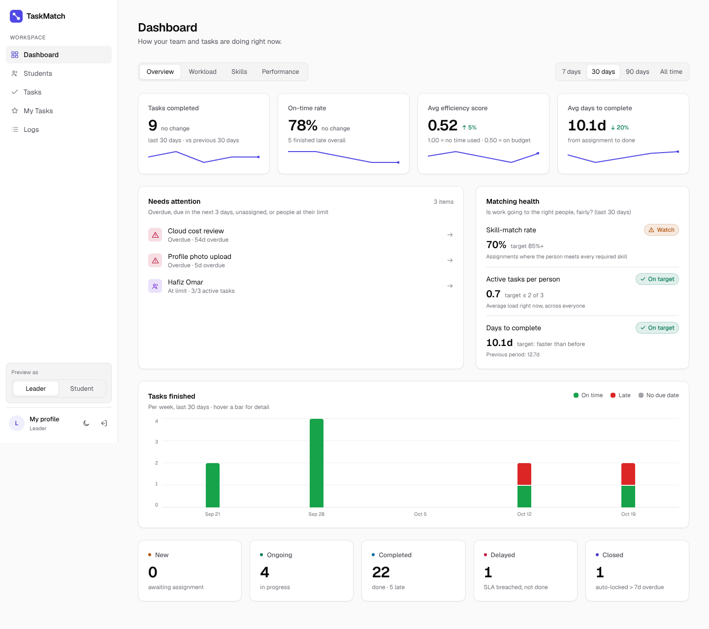 |

### Workload

| | Before | After |
|---|---|---|
| Dark | 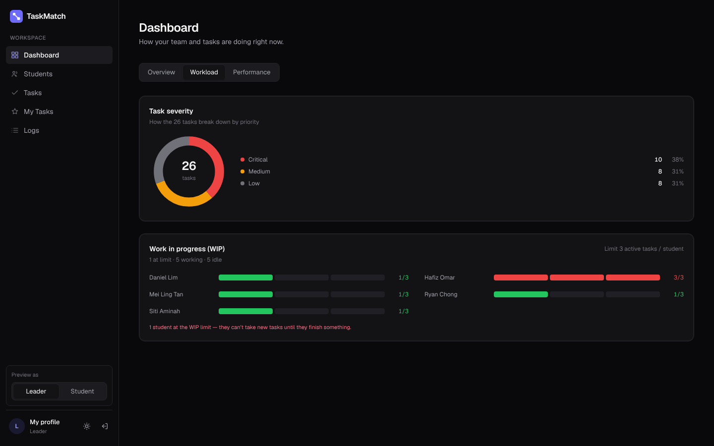 |  |
| Light | 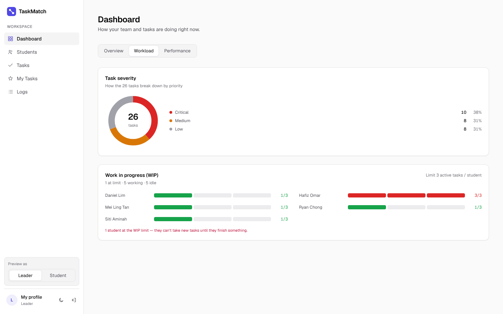 | 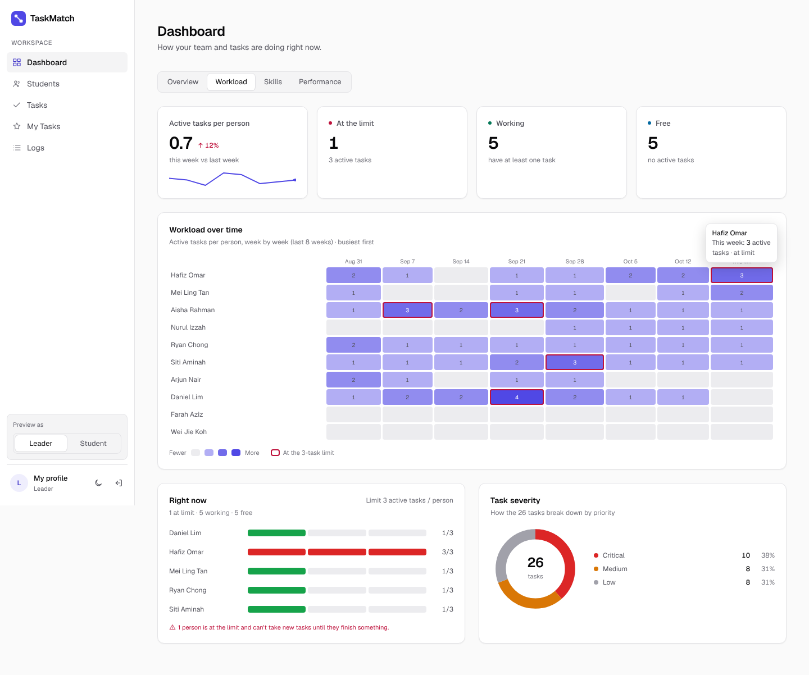 |

### Skills coverage (new)

| Dark | Light |
|---|---|
|  | 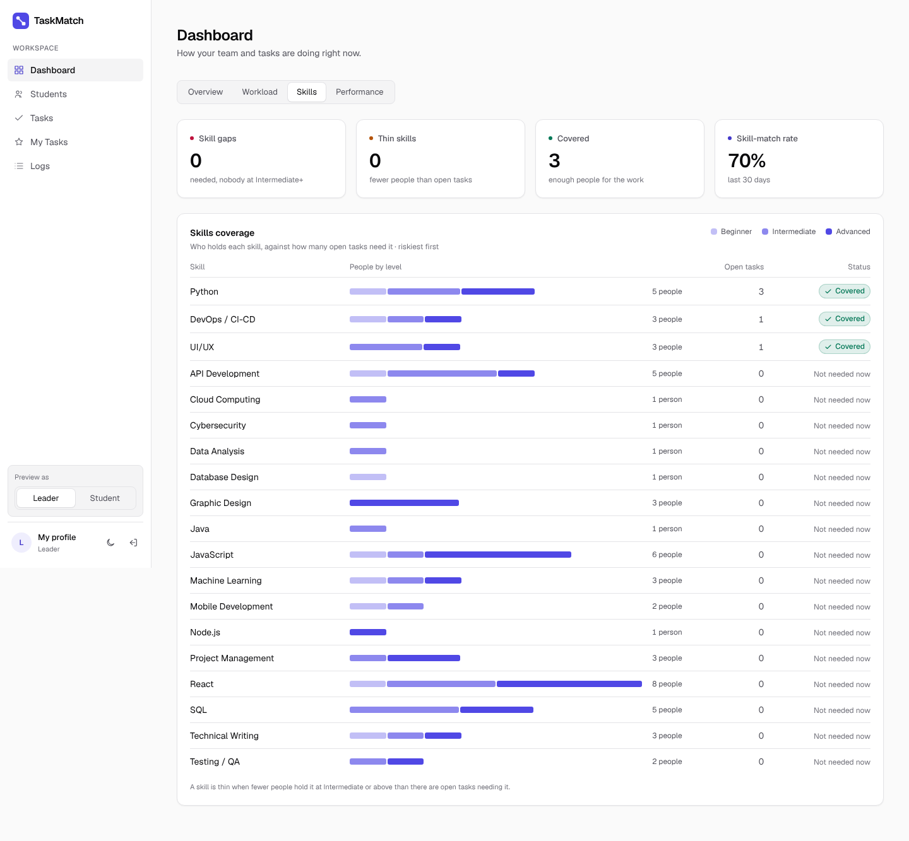 |

### Task detail: auto-assign

| | Before | After |
|---|---|---|
| Dark | 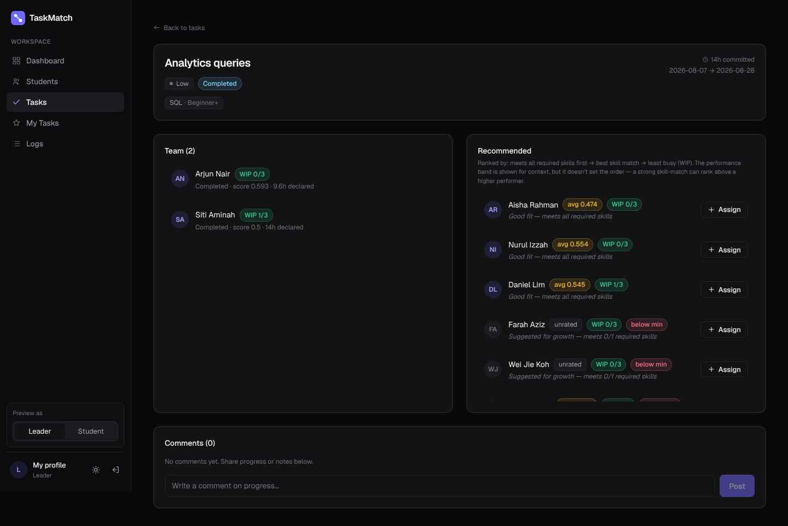 | 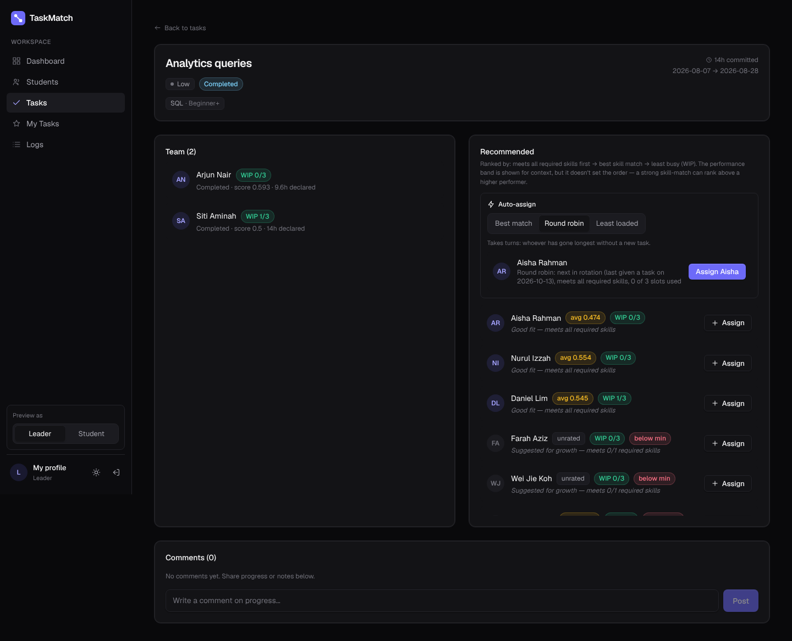 |
| Light | 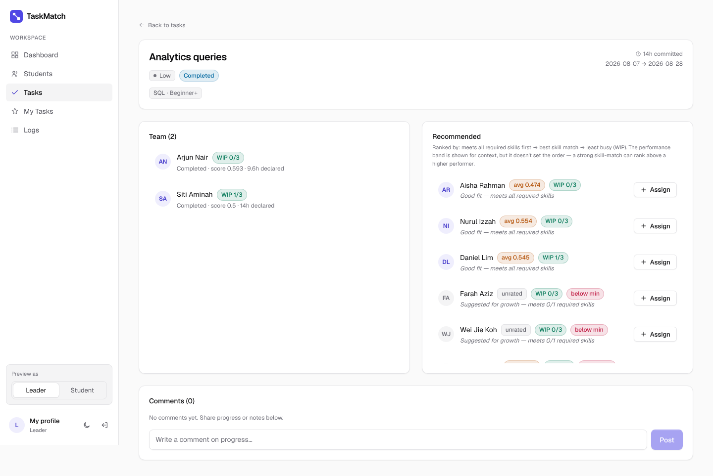 | 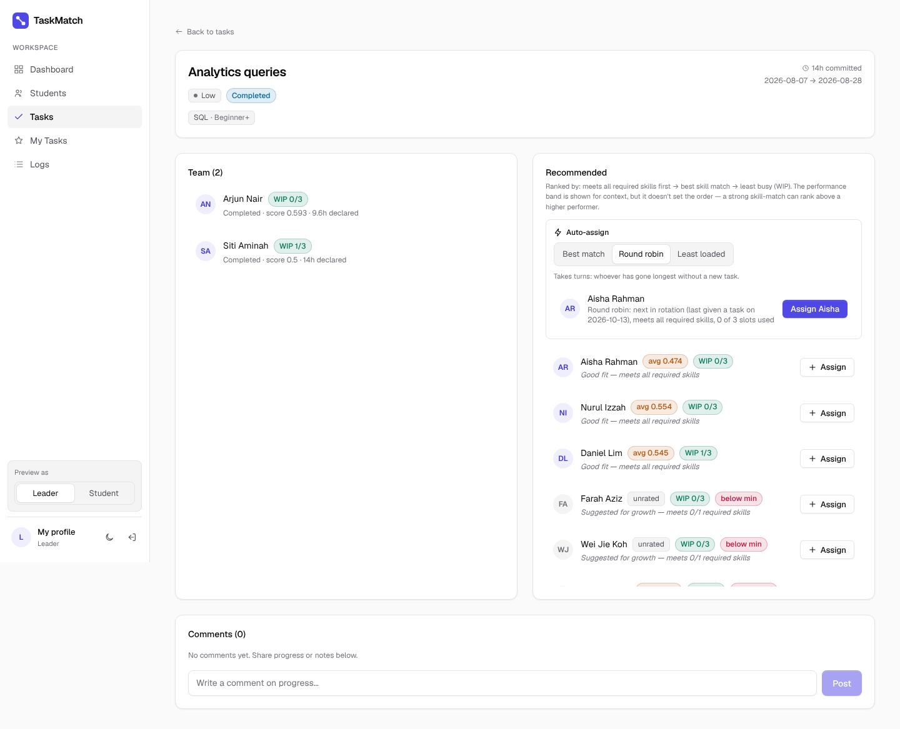 |

## How the screenshots were made

Both versions (`main` before this change, and this branch) were built and run locally with
Playwright. Supabase and the API were replaced by a script that serves the same seeded data to both,
so the before and after shots show identical numbers.

## Known limits

- The skill-match rate uses each person's **current** skill profile, not the profile they had when
  the task was assigned.
- Round robin uses the assignment date, so two tasks given on the same day are tied and the tie goes
  to whoever has had fewer tasks overall.
- An "away" status that round robin skips is planned for Phase 2, together with roles.
