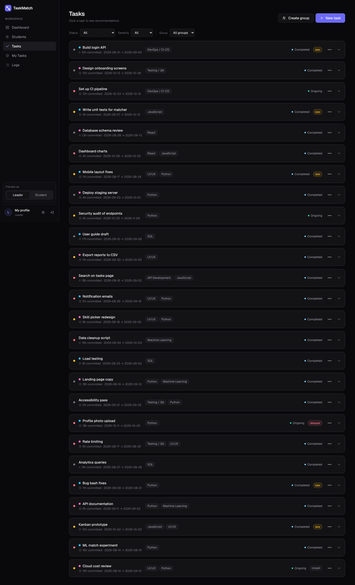
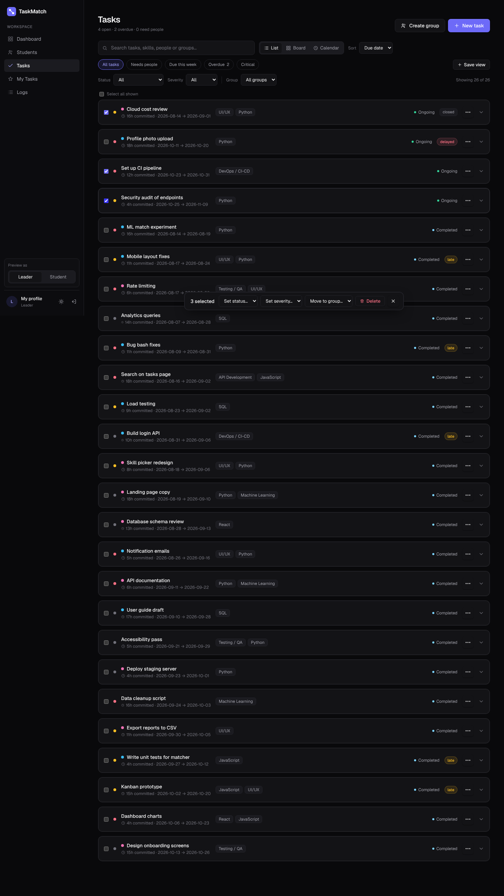
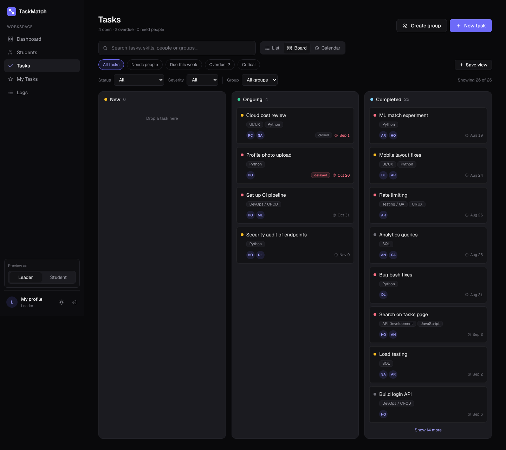
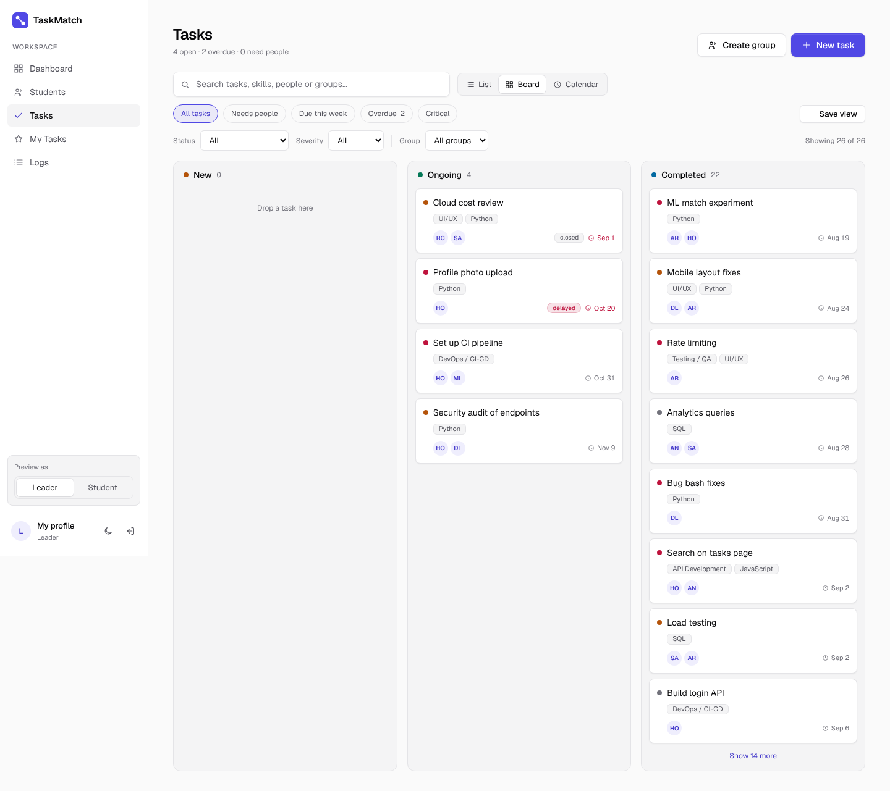
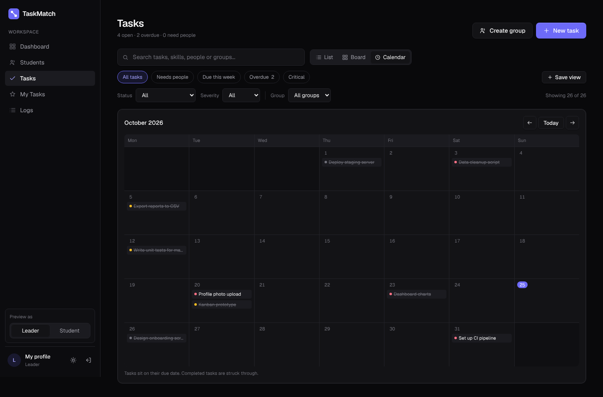
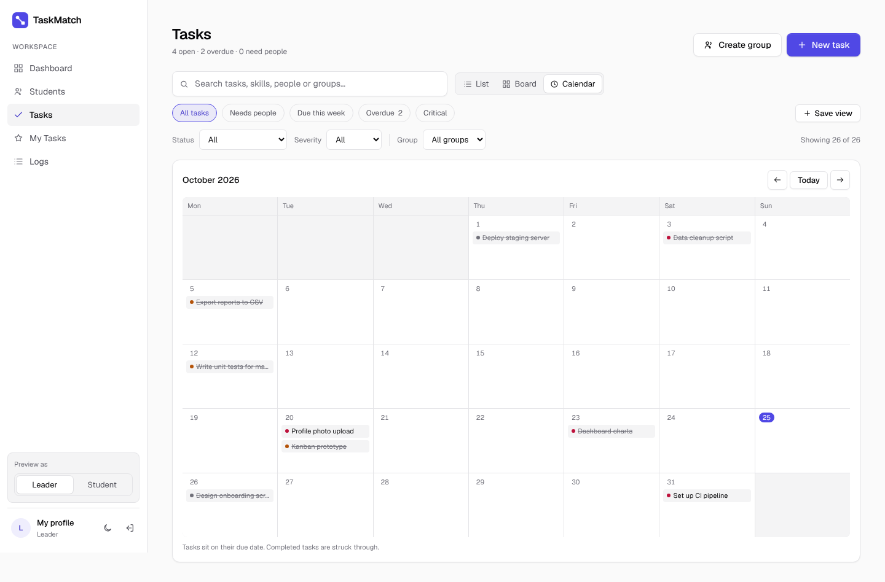
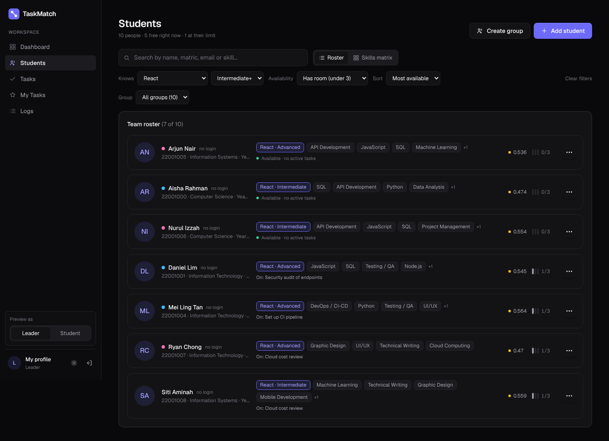
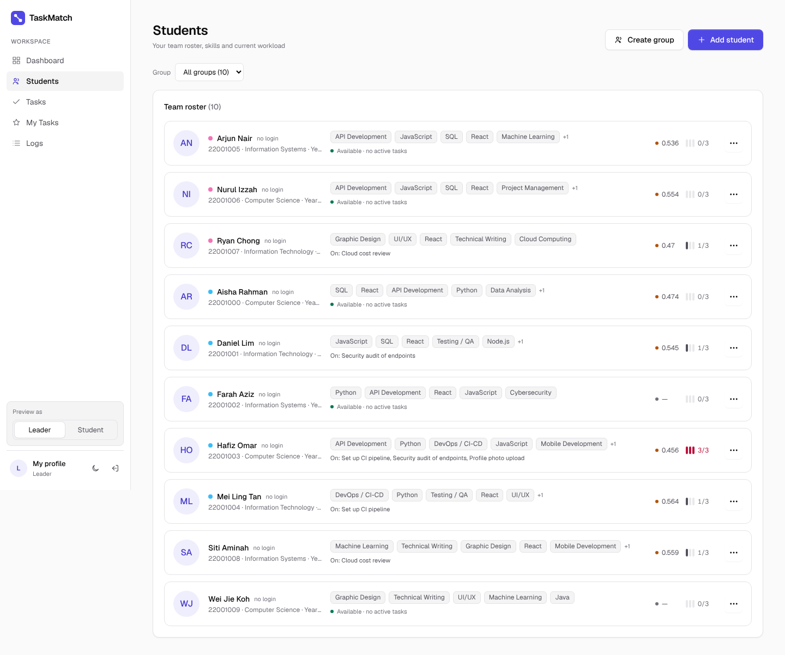
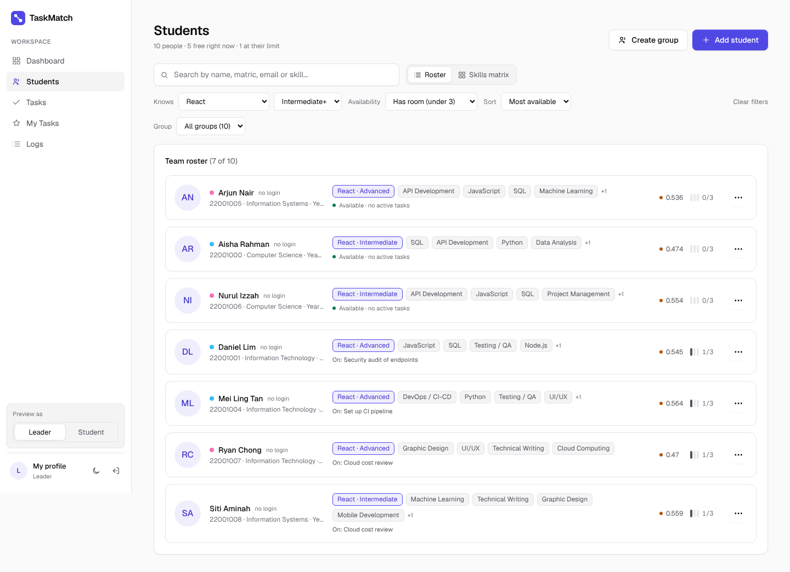
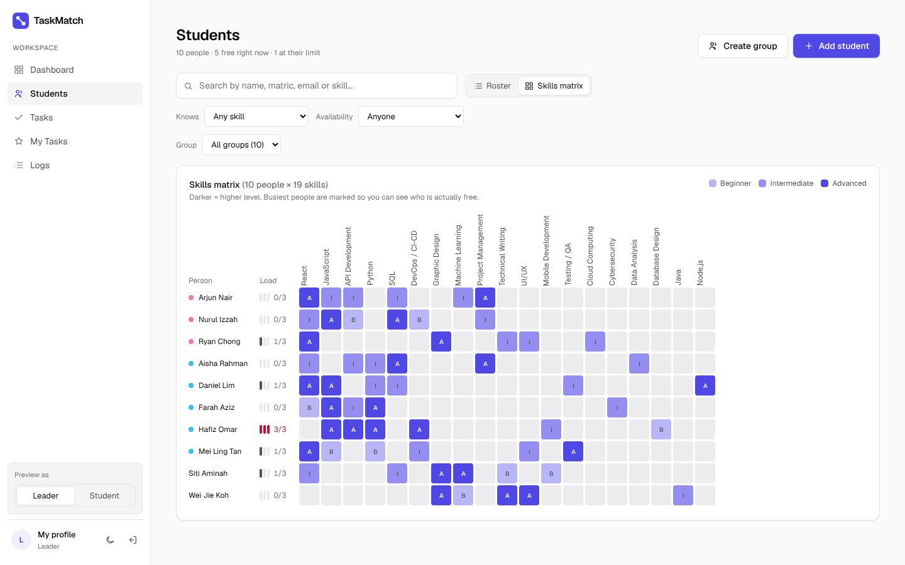

# TaskMatch 2.0: Phase 1b, Tasks and People pages (before / after)

Phase 1b of the feature overhaul. The Tasks and People pages used to be long, flat lists with a
few dropdowns. They are now working tools: find anything in a couple of keystrokes, see work as a
list, a board or a calendar, act on many tasks at once, and answer "who knows X and has room?"
without opening every profile.

No database or API changes were needed.

## What changed

### Tasks (`app/tasks/page.tsx`, `app/components/TaskViews.tsx`)

- **Three views** of the same filtered list:
  - **List**: the table, now with row checkboxes and a "needs people" flag on open tasks nobody is on.
  - **Board**: a column per stage (New, Ongoing, Completed). Leads drag a card to change its status;
    closed tasks can't be moved. Long columns fold after 8 cards.
  - **Calendar**: tasks on their due date, one month at a time, weeks starting Monday.
- **Search** across description, group, required skills and assignee names.
- **Quick views**: All, Needs people, Due this week, Overdue, Critical.
- **Saved views**: save the current search, filters, view and sort under a name and reapply it
  with one click. Clear filters resets everything.
- **Sort** by due date, severity, status, newest or name.
- **Bulk actions** (leads): select rows (or "Select all shown") and change status, severity or group,
  or delete, in one go. Status changes skip closed tasks. Every bulk change is written to the
  activity log.
- The header now says what matters: open tasks, overdue, and how many need people.
- Every filter, the search, the view and the sort live in the page address, so a filtered view
  can be bookmarked or shared.

### People (`app/students/page.tsx`)

- **Search** by name or email.
- **"Knows [skill] [level]+"** filter: e.g. everyone at Intermediate or above in a skill. Matching
  skill chips are highlighted with their level and listed first.
- **Availability** filter: free right now, has room, at their limit.
- **Sort** by group, name, most available or efficiency score.
- **Skills matrix** view: people down the side, skills across the top, each cell showing the level
  (B / I / A) with shading that deepens with level, plus a load meter per person. Click a skill
  header to filter by it.
- Header line: how many people, how many are free right now, how many are at their limit.
- Filters, view and sort live in the page address too.

## Screens

All screenshots use the same seeded demo data, at 1440×900.

### Tasks: list with bulk actions

| | Before | After |
|---|---|---|
| Dark |  |  |
| Light |  |  |

### Tasks: board (new)

| Dark | Light |
|---|---|
|  |  |

### Tasks: calendar (new)

| Dark | Light |
|---|---|
|  |  |

### People: filtered roster

The after shot is filtered to people who know one skill at Intermediate or above and still have
room, sorted by most available.

| | Before | After |
|---|---|---|
| Dark |  |  |
| Light |  |  |

### People: skills matrix (new)

| Dark | Light |
|---|---|
|  |  |

## How the screenshots were made

Both versions (`main` before this change, and this branch) were built and run locally with
Playwright against the same mocked Supabase and API data, so the before and after shots show
identical tasks and people.

## Known limits

- Board drag and drop uses the browser's built-in drag events, so it works with a mouse but not on
  touch screens. On a phone, change status from the task page or with bulk actions.
- Saved views are stored in the browser, so they don't follow you to another device yet. Storing
  them per account comes with roles in Phase 2.
- Bulk delete removes the selected tasks for good, after a confirmation.
