# TaskMatch 2.0: Phase 2, roles, permissions and audit trail (before / after)

Phase 2 of the feature overhaul. TaskMatch had two roles, leader and student, and the role was
stored somewhere any signed-in user could edit about themselves. Now there are four roles, each
action is checked by the API and by the database, admins manage roles on their own page, and
every change lands in an audit trail that can't be forged.

## Security fix first

Until now the role lived in the account's `user_metadata`. Supabase lets any signed-in user change
their own `user_metadata` from the browser, so **any student could make themselves a leader**,
and the API would believe them. On top of that, the database let any signed-in user change any
table, and anyone could switch the sidebar's "Preview as" to Leader.

Now:

- The role is stored in `app_metadata`, which only the server's secret key can change.
- The API checks a permission for every action, not just "is this a leader".
- Members can only start and complete **their own** assignments. Before, anyone signed in could
  start, complete or remove anyone's.
- The database has rules per role (`supabase/roles.sql`), so going around the app doesn't help.
- Audit entries are stamped with the real signed-in user by the database, so they can't be faked.
- "Preview as" is only shown to admins, and it only changes what they see.

## Roles

| | Admin | Team lead | Member | Viewer |
|---|:-:|:-:|:-:|:-:|
| Create, edit and delete tasks and groups | ✓ | ✓ | | |
| Add, edit and remove people and their skills | ✓ | ✓ | | |
| Assign and unassign anyone, use auto-assign | ✓ | ✓ | | |
| See scores, timed hours and performance | ✓ | ✓ | | |
| See the audit trail | ✓ | ✓ | | |
| Change roles and manage the team | ✓ | | | |
| Pick up, start and complete own tasks | ✓ | ✓ | ✓ | |
| Comment on tasks | ✓ | ✓ | ✓ | |
| Set own away status | ✓ | ✓ | ✓ | |

Viewers see tasks, people and the team dashboard, and change nothing. New accounts start as members.

The table lives in one place per layer and they are kept in step:
`taskmatch/app/lib/permissions.json` (the app), `ROLE_PERMISSIONS` in `taskmatch-api/main.py`
(a test compares the two) and `tm_can()` in `supabase/roles.sql`.

## What changed

### Team & roles page (`app/team/page.tsx`, admins)

- Tiles for each role with a count and a one-line description; click one to filter.
- Every login account with its role (change it from a dropdown, with a confirmation that says what
  the new role can do), whether it's on the roster, last sign-in and join date.
- "What each role can do": the table above, built from the same file the app uses.
- The API refuses to remove the last admin.

### Audit trail (`app/audit/page.tsx`, admins and team leads; replaces Logs)

- Date range (7, 30, 90 days or all), search, "what changed" and "who" filters, all kept in the address.
- Tiles for events, people active, role changes and deletions.
- Activity over time chart.
- Entries grouped by day. Open one to see the before and after of the change (for example
  `Medium → Critical`) and every detail recorded.
- Export the filtered entries to CSV.
- Old `/logs` links redirect here.

### Away status (`lib/away.ts`)

- People set themselves away from their profile ("Set away" / "I'm back"); leads can do it from
  the People page.
- Someone who is away is skipped by every auto-assign mode and shown as "away until …" in the
  recommendations, the roster and the cards.
- The People page has an "Away" availability filter and counts who is away.

### Everywhere else

- Buttons and panels show by permission (`can(role, 'tasks.manage')`), not by "is leader".
- Viewers can read comments but not post.
- The Students page and nav are now called People.

## Setting it up

Run [`supabase/roles.sql`](../supabase/roles.sql) once in the Supabase SQL Editor, after `rls.sql`.
It moves existing leaders to **admin** and everyone else to **member**, adds the away date column,
and switches on the per-role rules. It is safe to run again. The last query lists every account
with its new role so you can check it.

Deploy the new API at the same time. A role change takes effect straight away: the database reads
the role on every request rather than from the login token.

## Tests

- `taskmatch-api/test_roles.py` (new, 22 tests): the role comes from `app_metadata` and a
  `user_metadata` role is ignored; the permission table matches the app's; members, viewers and a
  user who edited their own `user_metadata` are all refused; only admins change roles; the last
  admin can't be demoted; members can start only their own work.
- `test_assignment_modes.py`: 3 new tests for away status.
- `supabase/roles.sql` was run (twice) against a local Postgres with a stand-in for Supabase's
  `auth` schema, and checked as a member, an admin, a viewer and a signed-out visitor.

## Screens

All screenshots use the same seeded demo data, at 1440×900.

### Team & roles (new)

| Dark | Light |
|---|---|
| 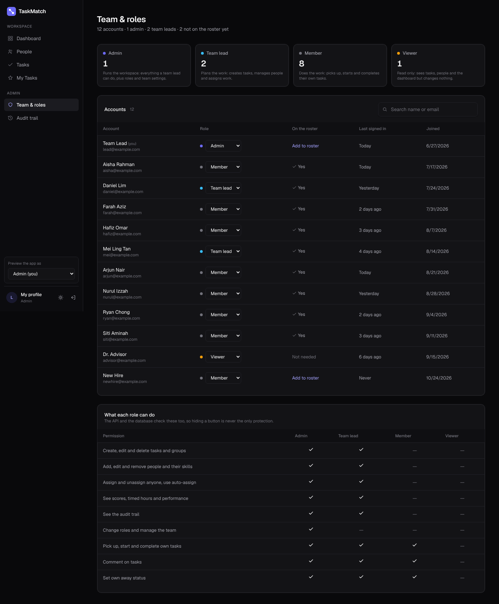 | 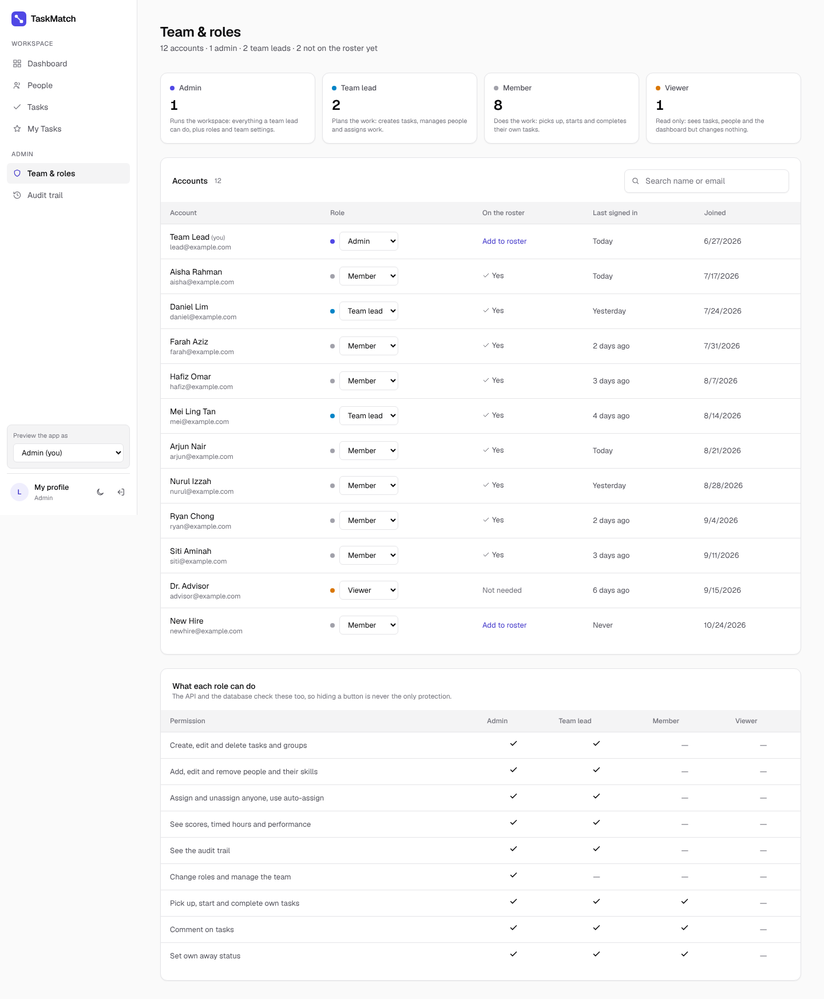 |

### Audit trail

| | Before (Logs) | After |
|---|---|---|
| Dark | 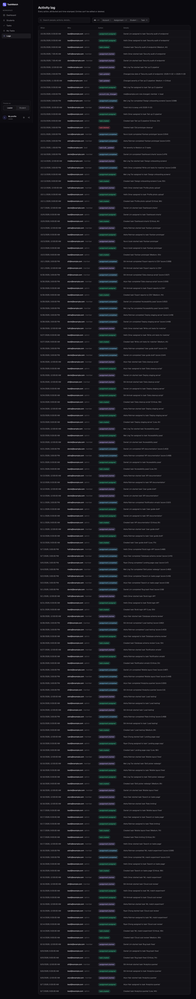 | 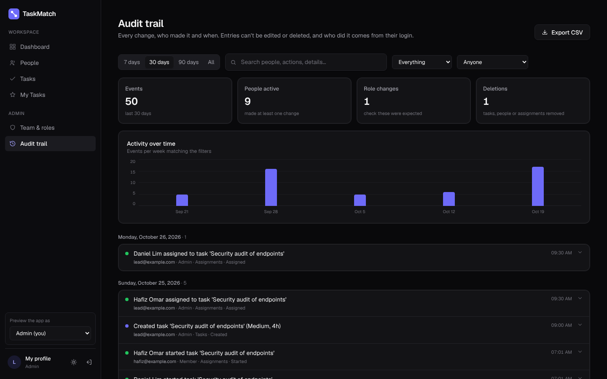 |
| Light | 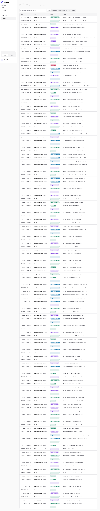 | 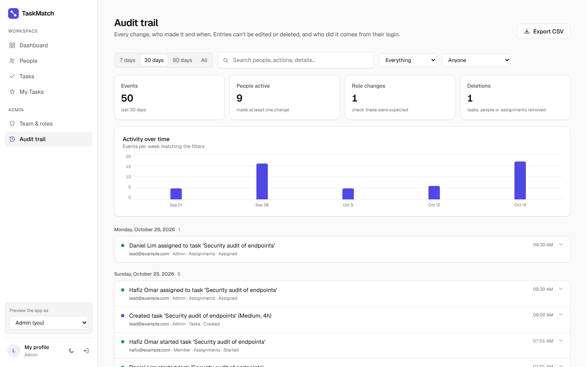 |

### An audit entry opened

| Dark | Light |
|---|---|
| 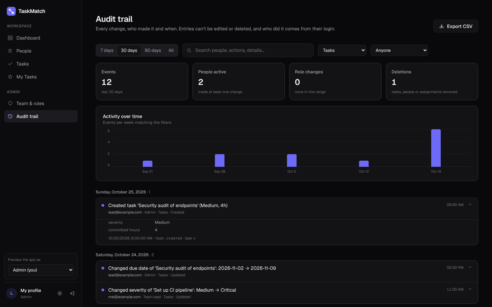 | 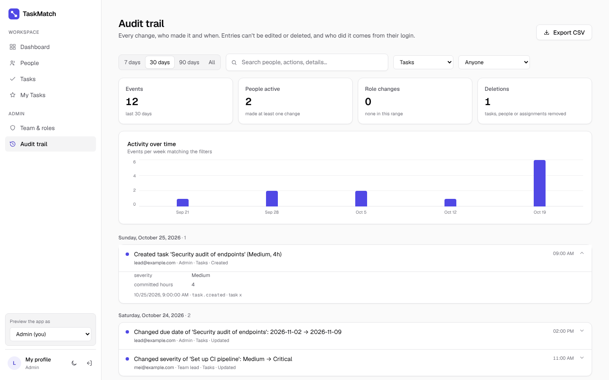 |

### People: role badges and away status

| | Before | After |
|---|---|---|
| Dark | 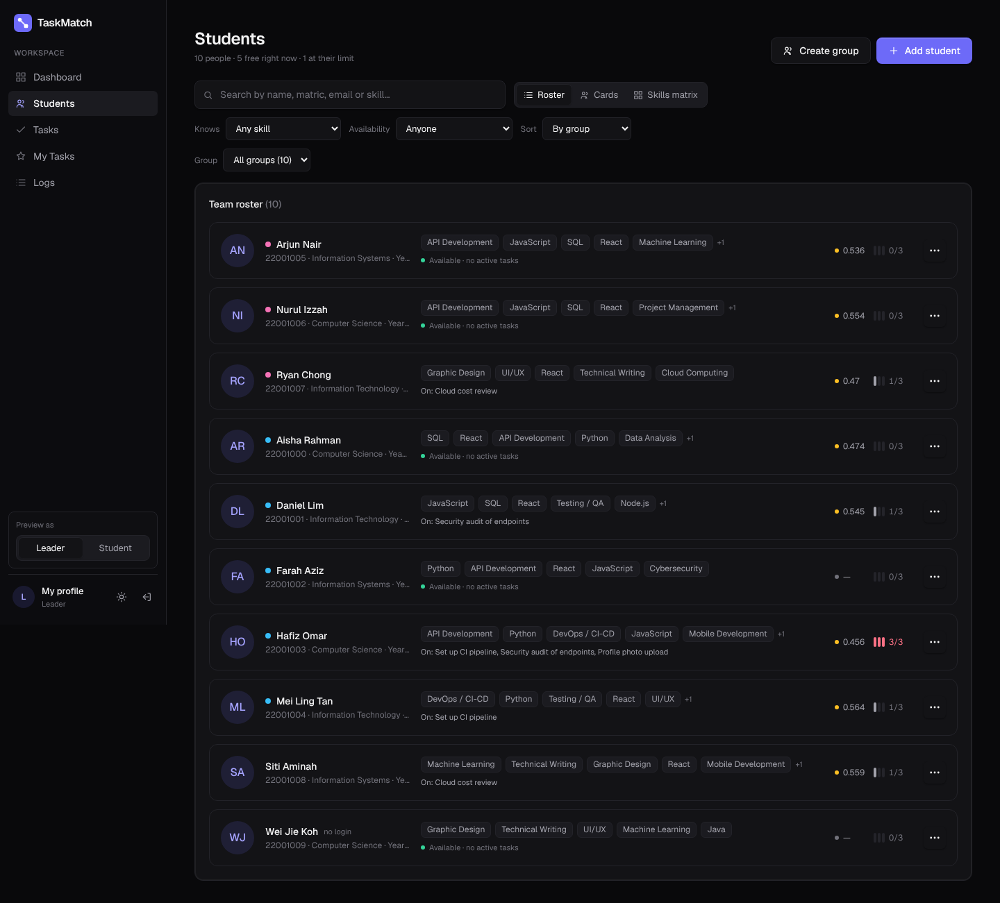 | 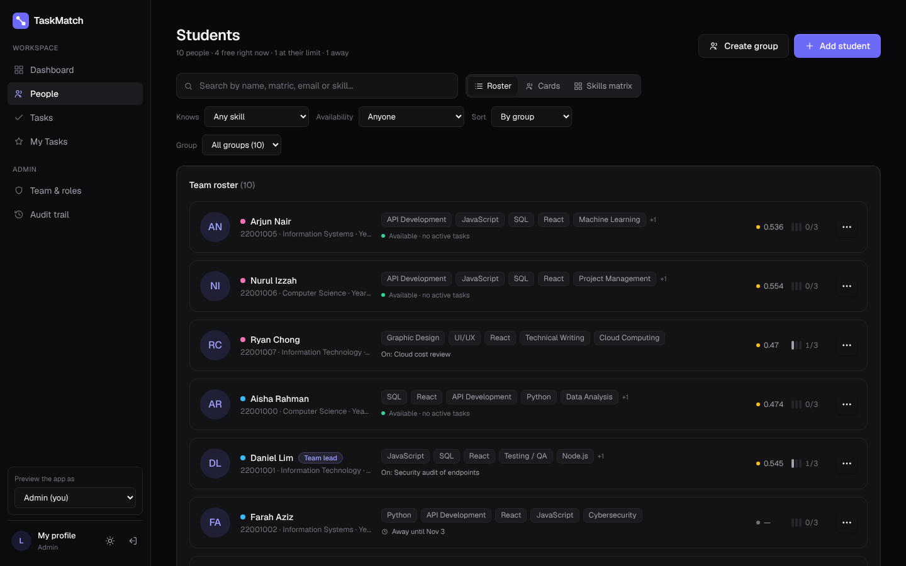 |
| Light | 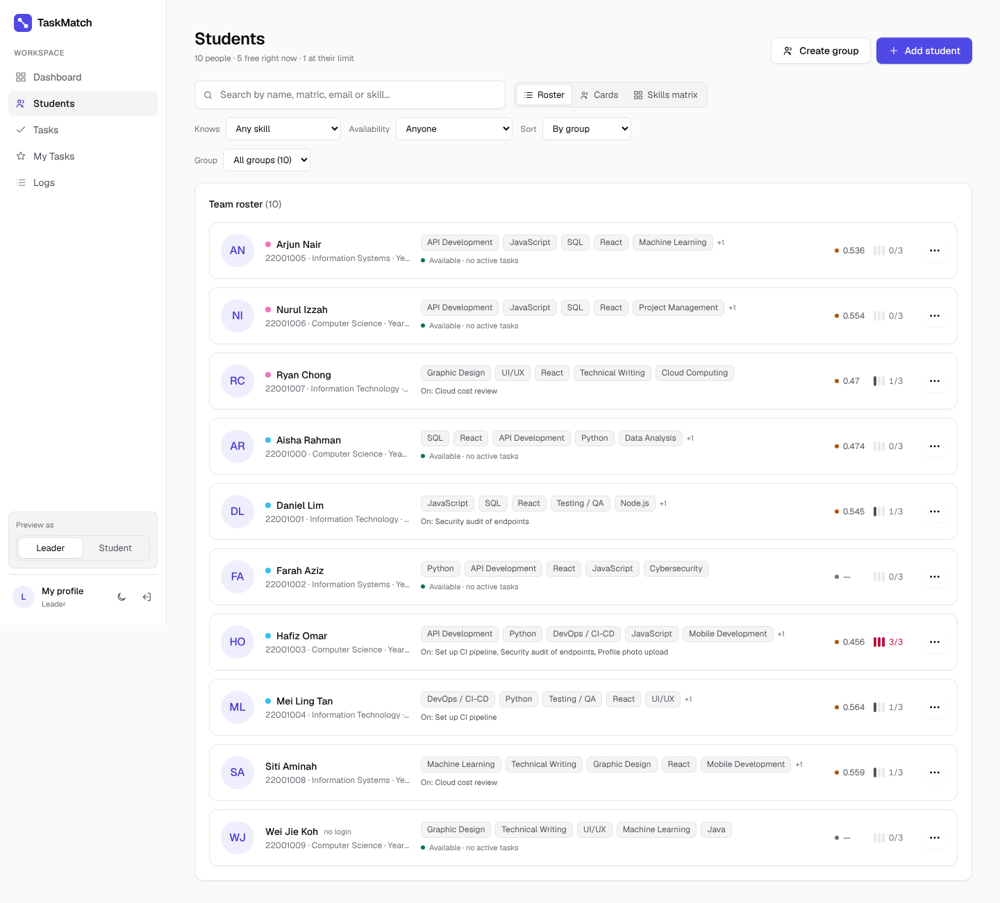 | 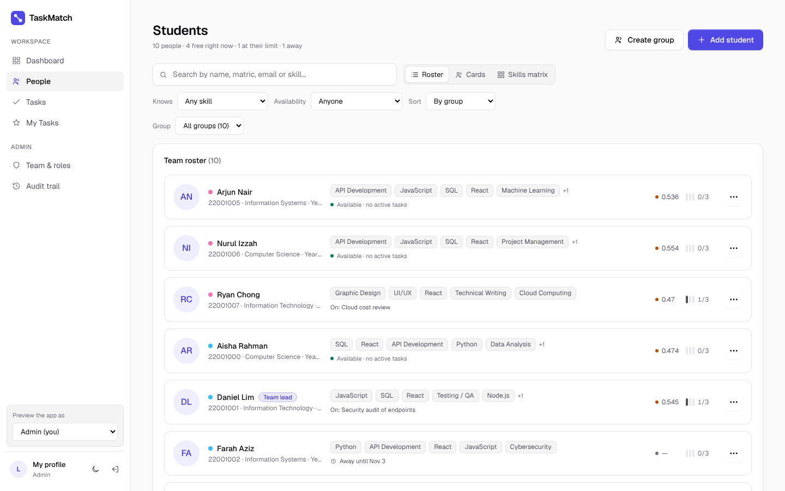 |

### A viewer's task panel (read only)

| Dark | Light |
|---|---|
| 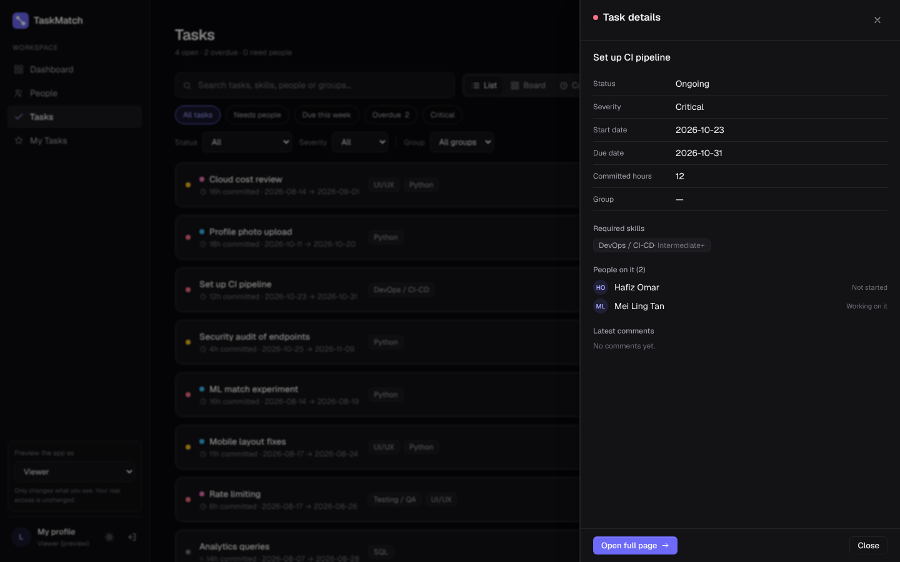 | 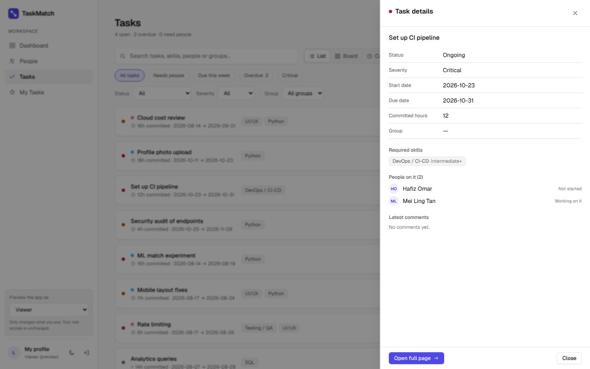 |

## Known limits

- Inviting someone by email needs mail set up in Supabase, so for now people sign up and an admin
  sets their role.
- Saved task views are still stored per browser.
- Profile photos in Supabase Storage keep the bucket's existing rules.
