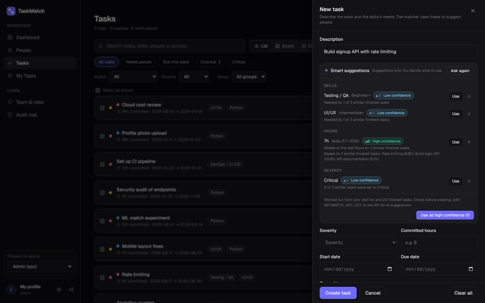
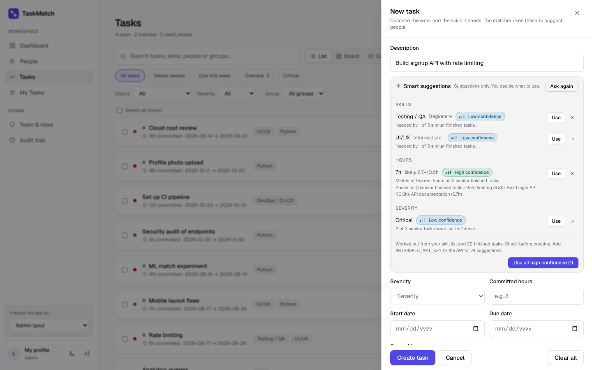
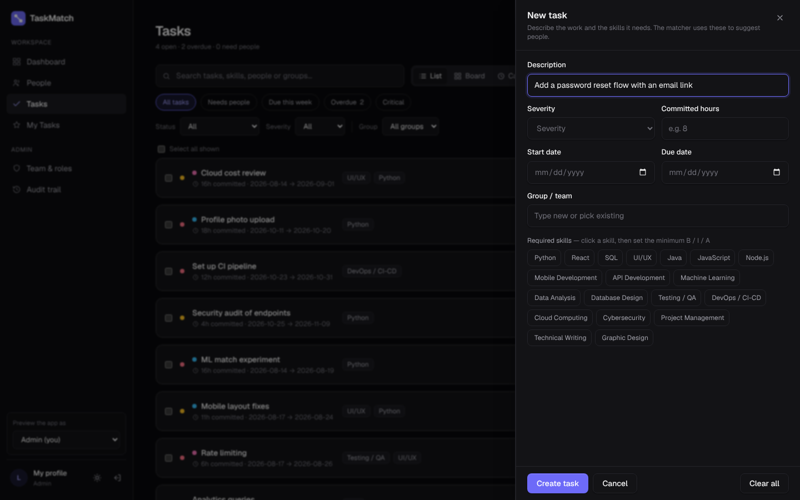
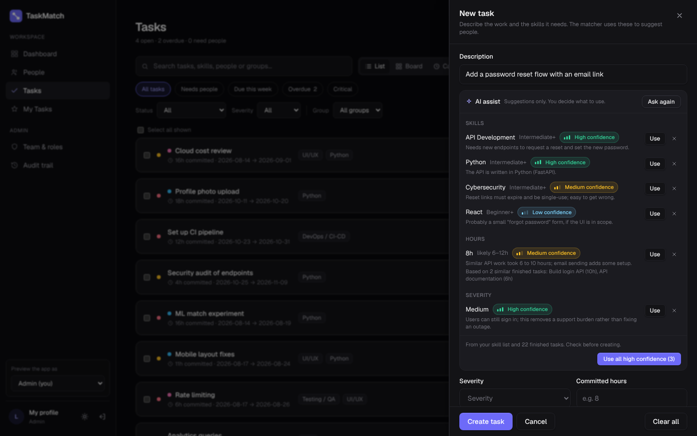
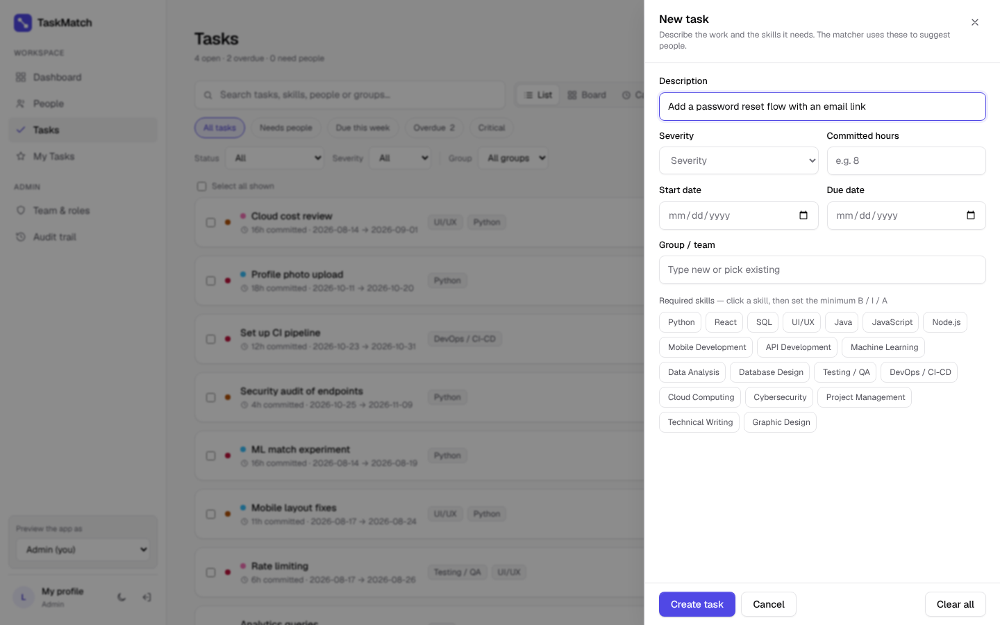
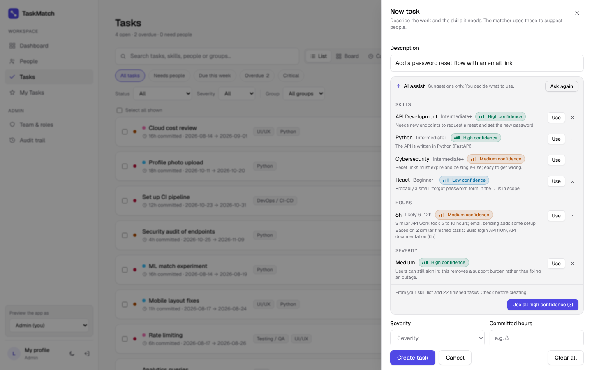
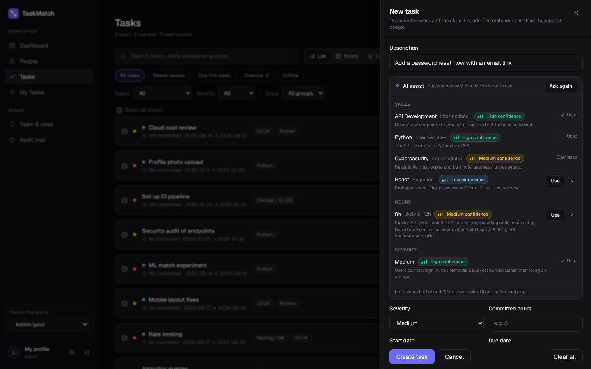
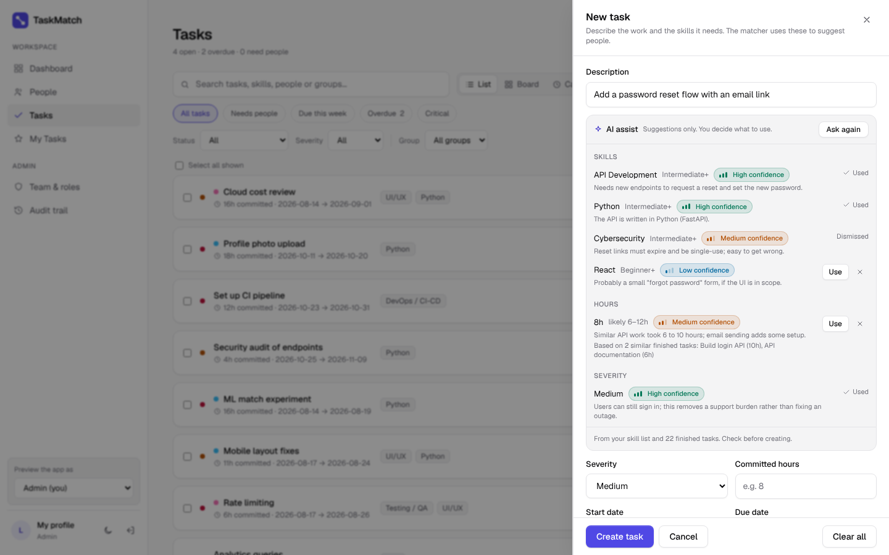

# TaskMatch 2.0: Phase 3, AI assist (before / after)

Setting up a task well is the slowest part of using TaskMatch. You have to pick the right skills
out of a long list, guess the hours and choose a severity, and the matcher is only as good as those
choices. Phase 3 adds an AI assistant to the New task panel that suggests all three.

It works with or without AI. With an Anthropic API key, Claude makes the suggestions. Without
one, a free built-in engine works them out from the team's own finished tasks (see
[Built-in suggestions](#built-in-suggestions-free-no-key)). The panel looks the same either way.

The rule throughout: **the AI suggests and a person decides.** Every suggestion shows how sure it
is and why. Nothing is filled in until the lead clicks **Use**, and the audit trail records what was
used and what was dismissed.

## What it does

- Type a description in **New task** and click **Suggest**.
- You get back:
  - **Skills** from your team's own skill list, each with a minimum level.
  - **Hours**, with a likely range, and the finished tasks the estimate was based on.
  - **Severity**.
- Each one has a **confidence level** (high, medium or low) and a one-line reason. The level is
  shown as a label and a small bar meter, so it doesn't rely on colour alone.
- **Use** fills that field in. **×** dismisses the suggestion. **Use all high confidence** takes
  only the ones the AI is most sure of.
- If the description is too vague, the AI says so and asks one question instead of guessing.
- When the task is created, a `suggestion.reviewed` entry goes to the audit trail. It lists
  each suggestion that was used or dismissed, with its confidence level. The audit trail has a new
  "Suggestions" filter.

## How the confidence level is kept honest

A model saying "high confidence" doesn't make it so. The server checks the answer against what it
actually knows:

- **Skills** can only come from your skill list. The request uses structured output with the skill
  names as a fixed list, and the server drops anything unknown or repeated.
- **Hours** are grounded in your own history. The AI is shown up to 40 recently finished tasks with
  their real hours, and it has to name the ones it based its estimate on. The server checks those
  tasks exist and caps the confidence by how many it found:
  - none: **low**, whatever the model said
  - one or two: at most **medium**
  - three or more: **high** allowed
- The app shows the tasks the estimate was based on, so the lead can see the evidence.
- Confidence can only be lowered by these checks, never raised.

## Safety and cost

- Only admins and team leads can ask for suggestions (`tasks.manage`), and each person is limited
  to 10 requests a minute.
- The task description is passed to the model as data inside `<task>` tags, with an instruction
  not to follow anything written in it.
- Nothing is written to the database by the AI endpoint. The task is only saved when the lead
  clicks **Create task**, as before.
- The task description, your skill names and the finished-task descriptions are sent to Anthropic's
  API to make the suggestion. Names, emails and scores are not sent.
- The model is Claude Opus 5.5 at low effort (this is a quick classification, not deep reasoning).
  It can be changed with `AI_MODEL`. If the model declines a request, the API retries it on
  Anthropic's recommended fallback model (`fallbacks: "default"`).
- Without `ANTHROPIC_API_KEY`, Claude is never called and nothing is sent anywhere: the built-in
  engine answers instead, and admins see a one-line hint on how to switch on AI.

## Built-in suggestions (free, no key)

`taskmatch-api/suggest_history.py` runs when there is no API key. It isn't AI. It looks for
finished tasks with similar wording, and uses them like this:

- **Skills**: the skills those tasks needed, weighted by how similar each task is, plus any skill
  named in the description. High confidence needs the skill named and seen in a similar task, or
  seen in three similar tasks. A skill seen in only one loose match isn't suggested.
- **Hours**: the middle of the real hours on the similar tasks, with their range. High confidence
  needs three close matches. With no matches it falls back to the team's typical task size, at low
  confidence.
- **Severity**: words like "urgent", "crash" or "security" point to Critical, and "typo" or
  "polish" point to Low. Otherwise it goes by what similar tasks were set to.
- If nothing is similar and no skill is named, it asks for more detail.

It gets better as the team finishes more tasks.

| Dark | Light |
|---|---|
|  |  |

## Setting up AI (optional)

1. Create a key at console.anthropic.com under **API keys** (add some credit under **Billing**).
2. On Render, open the API service, go to **Environment**, and add `ANTHROPIC_API_KEY` with the key.
3. Render redeploys. In **Tasks → New task** the box is now called **AI assist** instead of
   **Smart suggestions**.

No database changes are needed.

## What changed

| File | Change |
|---|---|
| `taskmatch-api/ai.py` (new) | Prompt, structured-output schema, the evidence checks, and the Claude call |
| `taskmatch-api/suggest_history.py` (new) | The free built-in engine |
| `taskmatch-api/main.py` | `GET /ai/status`, `POST /ai/suggest-task`, a per-user AI rate limit, clear errors for refusals, rate limits and a bad key |
| `taskmatch-api/requirements.txt` | `anthropic` SDK |
| `taskmatch/app/components/AISuggest.tsx` (new) | The AI assist panel and the confidence badge |
| `taskmatch/app/tasks/page.tsx` | AI assist in the New task panel; the review is logged when the task is created |
| `taskmatch/app/audit/page.tsx` | "Suggestions" category |

## Tests

`taskmatch-api/test_ai.py` (new, 17 tests). The model is never called; a fake stands in.

- The schema only allows your skill names and levels 1 to 3.
- Unknown and repeated skills are dropped, and bad levels are clamped.
- Hours confidence is capped by the number of real similar tasks; made-up task ids count for nothing.
- Low confidence is never raised.
- The hours range always contains the estimate.
- A refusal is reported, not parsed.
- The request uses structured output and the fallback setting.
- Members and viewers get 403. With no key the built-in engine answers and Claude isn't called. Over-long descriptions are rejected. The per-user limit works.

`taskmatch-api/test_suggest_history.py` (new, 9 tests): similar tasks give confident skills and
hours, real hours beat planned ones, a named skill is suggested without history, nothing similar
asks for detail, urgent and minor words set severity, one loose match isn't enough for a skill,
and the answer has the same shape as the AI's.

104 API tests pass in total. The request shape was also checked against the real SDK with a local
stand-in server.

## Screens

All screenshots use the same seeded demo data, at 1440×900. The AI answer in the "after" shots is
a fixed example, not a live call.

### New task

| | Before | After |
|---|---|---|
| Dark |  |  |
| Light |  |  |

### After reviewing: high-confidence suggestions used, one dismissed

| Dark | Light |
|---|---|
|  |  |

## Next

Workspaces and projects (multi-org, like Jira), then the notification centre built on top of them.
